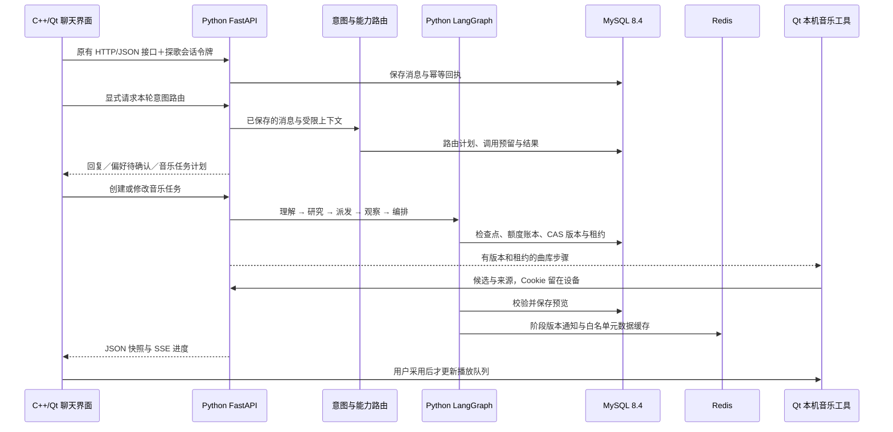

# 探歌 Python 后台

开发前阅读 [Harness 规范](../docs/HARNESS_ENGINEERING.md) 与 [能力缺口](../docs/HARNESS_STATUS.json)。统一快速验证：`python3 scripts/verify-harness.py --tier quick`（仓库根目录执行）；数据库及原生桌面另用 `mysql`／`native`，未执行的层级不算通过。

当前后台为 Python FastAPI＋Python LangGraph，共享存储使用 **MySQL 8.4/InnoDB＋Redis**。C++/Qt 继续负责界面、播放、本机曲库与确认式偏好；Python 负责账号、额度、会话、意图路由和音乐任务。后台直接执行业务代码，不通过子进程转发给旧 JavaScript Agent。

## 怎么接入客户端



`AppBackendClient` 使用 `QNetworkAccessManager` 调用后台，HTTP 路径、Bearer 会话、JSON 字段及 SSE 协议保持兼容，不把 Python 嵌进 C++。开发地址默认 `http://127.0.0.1:16383`，普通模式为 `16382`；远程部署要求 HTTPS。

LangGraph `StateGraph` 执行当前固定音乐工作流。业务恢复由 MySQL 检查点、CAS、租约和调用账本负责；Redis 不决定任务是否成功。数据库迁移不代表已经实现 MCP、动态 Supervisor 或新模型效果。

## 本机运行与配置

项目使用 Python 3.12，`uv.lock` 固定依赖。macOS 需要 `uv`、MySQL 8.4、Redis 及现有 Qt/Node 依赖。尚未安装数据库工具时先执行：

```bash
brew install mysql@8.4 redis
uv sync --project backend_py --python 3.12 --frozen
```

依赖安装后，`ensure_storage` 只管理本项目独立的本机实例，不启动或停止 `brew services`，不修改系统默认数据库。

- 双击根目录 `run-macos.command`，或 VS Code 按 F5：准备选定的数据库服务并启动受保护的开发免登录后台。
- 单独运行普通后台：`bash scripts/start-app-backend.sh`，默认关闭开发免登录。
- 仅运行 Python 后台：`uv run --project backend_py --frozen tango-backend`。
- 隔离测试进程可用 `python -m tango_backend.server --no-env`，必须显式提供测试存储和监听配置。

模型配置由后台加载 `backend_py/.env`，公开模板为 [.env.example](.env.example)；日志与显式离线兼容文件位于私有 `backend_py/.data/`。当前 MySQL/Redis 私有配置在 `.local/mysql-v1/storage.env`；`ensure_storage.py` 负责本机依赖准备，受保护的 `.local/mysql-v1/active.json` 显式选择 MySQL。旧 `.local/storage-v1/` 中的 PostgreSQL 配置、源库与备份保留供迁移核验；未切换时识别旧配置，切换后故障不自动回写旧库。不会用空 MySQL 库替换已有账号。

多模型配置与启用步骤见 [独立阶段说明](../docs/MODEL_ROUTING.md)。默认 `QWEN_MODEL_STRATEGY=flash_only`、`QWEN_PLUS_ENABLED=false`；可以先填 `QWEN_PLUS_*`，之后显式启用 `task_split`。相同规范化 base URL 可沿用原 Key，不同端点须显式填写 Plus Key。意图固定 Flash，复杂任务规划／研究可选 Plus，其余规则与预算保留。环境配置变更需要重启对应后台；启动器通过 `modelRoutingVersion: 1` 拒绝复用不支持多模型的旧进程。

`/health` 应包含 `runtimeLanguage: "python"`、`runtimeVersion: 2`、`modelRoutingVersion: 1`、`storage: "mysql"`、`rateLimiter: "redis"`；`/ready` 检查实际依赖连接。启动器拒绝占用端口的旧后台或错误配置实例。

Qt 的历史、收藏、偏好和网易云授权仍留在设备；模型 Key、会话明文、Cookie、数据库及私有配置不提交仓库。

## 代码位置

| 文件 | 作用 |
| --- | --- |
| `tango_backend/server.py`、`app.py` | 配置加载、FastAPI 接口、认证与限流 |
| `tango_backend/storage_db.py`、`mysql_store.py` | asyncmy 连接池、事务、行锁与账号存储 |
| `tango_backend/migrations/001_initial_mysql.sql` | InnoDB 完整表结构及二进制排序规则 |
| `tango_backend/mysql_task_store.py` | 任务 CAS、worker 租约、模型槽位与调用账本 |
| `tango_backend/account_quota.py`、`invite_store.py` | 原子账号额度、内测码消费与注册保护 |
| `tango_backend/conversation_store.py`、`conversation_route_store.py` | 独立会话、持久回执与路由尝试 |
| `tango_backend/intent_routing.py`、`conversation_router.py` | 类型化能力计划、授权守卫与执行协调 |
| `tango_backend/task_runtime.py`、`task_model.py` | LangGraph 生命周期、需求理解与候选排序 |
| `tango_backend/task_schema.py` | 真实曲目、证据和硬约束校验 |
| `tango_backend/task_progress.py`、`task_tool_cache.py` | SSE、Redis 版本通知和有界缓存 |
| `tango_backend/ensure_storage.py`、`storage_profile.py` | 本机依赖准备和显式存储选择 |
| `tango_backend/migrate_mysql.py`、`admin.py` | PG→MySQL 离线迁移与显式数据库管理 |

旧 JavaScript AI 后台及历史脚本已从当前源码树移除，当前接入与能力边界见 [Agent 设计](../docs/AGENT_DESIGN.md)，历史清理范围见 [冻结记录](../docs/agent-upgrade/legacy-cleanup-verification.json)。`service/` 的第三方网易云 Node.js 适配服务仍在使用。PG 适配用于旧数据迁移与兼容验证；SQLite 后台适配仅供显式离线开发及兼容测试，不是故障回退。

## 验证

维护者查看实际会话、路由、任务、工具、约束与调用账本，可使用 [只读诊断命令](../docs/AGENT_DIAGNOSTICS.md)。仓库根目录执行 `bash scripts/diagnose-agent.sh recent`，再按会话或任务ID查询；该入口不启动服务、不迁移数据库、不恢复任务或调用模型。

网页执行树可接 [LangSmith 云服务](../docs/LANGSMITH_TRACING.md)：使用后台专用开关和独立观测密钥，默认关闭；只上传受控摘要。`bash scripts/langsmith-demo.sh` 在临时库运行实际业务代码并生成本地树；显式 `--upload` 才发送该次模拟上游的脱敏执行记录，不调用真实模型或曲库。配置、云端接收和网页展示需分别核验。

```bash
uv sync --project backend_py --python 3.12 --frozen
# 无独立数据库地址时，相关专项会跳过
uv run --directory backend_py python -m pytest tests -q
# MySQL/Redis：运行器独立建库、起服务并清理
uv run --directory backend_py python tests/run_mysql_suite.py --log /tmp/tango-mysql-tests.log
# PG 旧数据兼容路径：使用另一组独立临时 PG/Redis
uv run --directory backend_py python tests/run_storage_suite.py --log /tmp/tango-pg-compat-tests.log
```

运行器不会读取真实 `.env` 或复用现有账号库。MySQL 与 PG 专项需要分别执行，不能把未配置数据库时的跳过算作通过。Qt 集成使用真实 C++ 客户端与 Python HTTP 进程，模型和曲库为隔离替身。本次没有新增真实模型调用，工程通过率不等于推荐准确率。

当前迁移流程、专项证据和面试说明见 [MySQL 迁移说明](../docs/MYSQL_MIGRATION.md)。Python 迁移的历史结果保留于 [冻结证据](../docs/agent-upgrade/python-migration-verification.json)，不作为当前模型效果成绩。

### 聊天工作区清除接口

`DELETE /v1/conversations` 接收当前账号 Bearer 和 `{requestId}`，返回同 ID 的清除回执。按账号锁和事务清除全部设备的持久助手聊天，保留任务审计、额度及采用事实；墓碑阻止迟到路由及旧任务恢复。客户端先落盘编号，结果未知只核对同一请求。此功能不是个人数据物理删除。`health` 与 Agent 状态声明 `conversationClearVersion: 1`，本机启动器拒绝复用旧后台。流程、源码和测试见[聊天工作区交付](../docs/AGENT_CHAT_WORKSPACE.md)。


音乐需求阶段新增 `musicIntentVersion:1`，本机启动器拒绝旧后台。`GET /v1/agent/skills` 使用当前账号认证，返回受限音乐Skill注册表；正式路由用同一能力绑定校验。普通艺人作品与已有歌单为只读能力，复合生成任务统一保存场景、艺人、时长及原文来源；仍需设备曲库与明确采用。架构、代码和验收见[音乐需求阶段](../docs/AGENT_MUSIC_REQUIREMENTS.md)。
