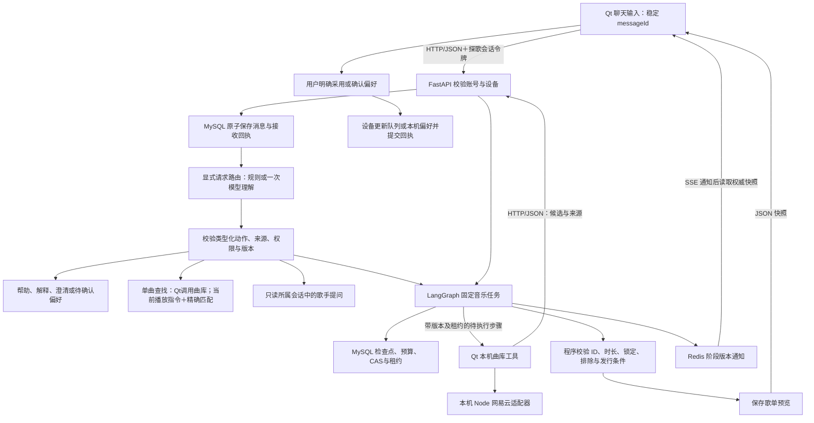

# 探歌 Agent：当前设计与工作流

本轮[演示稳定性修复](AGENT_DEMO_STABILITY.md)已补完整单曲、版本和只读修饰、含日期/身份限定的新作查询、受限复合偏好与歌单、帮助历史和原任务控制。规则路径完整消费受支持原句；模型路径共用机器Schema和提示词，提案仍须经过来源、权限、任务ID/revision与依赖校验。它改善既有固定图的入口可靠性，不增加动态Supervisor或MCP。工程quick Python1758通过/28跳过、Node53，固定上游真实Qt核心10任务23交互另1前置、88检查通过；见[证据](agent-upgrade/demo-stability-verification.json)。最终拥有者MySQL/Redis2309通过/63跳过、native6/5/57/27通过；锁检查按实际曲目刷新，已核验采用终态不被晚unknown覆盖，真unknown仍不重派。另按新60次授权单次运行8次真实请求、18观察，4流程通过、1指定版本未核、1发行失败；单次付费Schema路由已返回HTTP200并过正式校验。发行“只做预览”等附句随后仅离线修复，原真实失败保持，不自动重跑；未获得总体准确率、真实听感或整首会员播放结论。

最近一次[真实质量结果](AGENT_REPAIRED_QUALITY_RESULTS.md)：单次46/350次、新题4/16、回归8/8客观通过，整体业务10通过/12失败/2人工待评。该轮暴露的单曲解析和路由契约已在上述阶段进行工程修复，修后自由表达效果仍未得到真实验收；不将工程回归、成功接口或接受路由当总体准确率。评分器安全误报已独立校正并保留原始报告；真实MCP/动态Supervisor不是本轮已实现能力。

先前[修复后质量验收准备](AGENT_REPAIRED_QUALITY_EVALUATION.md)建立版本化白名单题集16新任务＋8暴露回归，冻结输入、真实界面和持久终态判据、共享请求账本及具名复核；52次交互另3前置。意图/行动契约、路由关键字段与编译后的任务字段分开记录来源，未知留在分母。离线新题目录只封存协议，不运行替身答案；后续真实执行成绩保留在上一段所链原报告。该阶段改评测系统，不改音乐产品图、不新增动态多Agent或真实MCP。

更新：2026-10-24。本文说明当前 Python＋MySQL 版本；计划与缺口见 [升级路线](AGENT_UPGRADE_ROADMAP.md) 和 [能力清单](HARNESS_STATUS.json)。聊天入口、单曲查找、受限歌手历史和发行隔离的本步修复与局限见 [交付说明](AGENT_CHAT_REPAIR.md)。

当前增加了 [受限复合需求与演示闭环](AGENT_DEMO_RELEASE.md)：能完整解释的分句先编译为已有能力计划，自由表达仍交模型；两条路径使用同一校验器，执行图与权限边界保持原设计。

新题之后的[业务与恢复修复](AGENT_E2E_REPAIR.md)将目标总曲数与保留前缀分离，补完整单曲/版本、偏好操作、原任务控制和权威澄清；采用在派发前持久记录原ID，后台同事务保存原动作/版本，未知只查询且不自动播放。仍使用当前固定图与同一权限校验器，没有改成动态多Agent。修复工程链路通过不代表真实模型修后语义已测，原新题分数不改。

后续[残留复核](AGENT_RESIDUAL_REPAIR.md)纠正前次覆盖不足：偏好用途与单曲附句共用整句校验；任务明确拒绝需可信完整协议事实，普通恢复也须匹配冻结的原action、目标及revision。上轮十题成绩不等于原24题全修复，多轮lookup候选消歧仍待补。

## 聊天工作区与清除边界

当前新增[聊天工作区](AGENT_CHAT_WORKSPACE.md)：Qt 使用可见 `QTextBrowser` 呈现右侧用户、左侧助手气泡，候选链接只绑定当前账号和候选版本，点击复用原 `playOnlineSong`，不隐式采用整张预览。`DELETE /v1/conversations` 按当前探歌账号事务清除持久聊天，MySQL 墓碑拒绝旧消息及旧任务继续提交；原调用和采用审计仍保留。客户端在请求前落盘清除编号，未知结果只核对同一编号，废止旧网络回调，成功后清理本机待确认路由；偏好、队列和额度独立保留。此改动不增加模型角色，也不证明语义质量提升。

## 作用与技术分工

已补[多轮单曲候选上下文](AGENT_LOOKUP_CONTEXT.md)：Qt保存当前账号会话的原候选池和可见顺序，后续明确指代经原路由来源、根期限及派生校验后返回只读`music.refine`，设备再次核候选集合执行。候选内容不进入模型，未知声线先澄清；不继承播放权限。它是受限选择能力，仍不是动态Supervisor。

用户在同一个聊天框找歌、查询新作、修改歌单和提出偏好；系统把交流、执行和确认分开，避免聊天刷新丢记录、重复请求和未经确认播放。

- **C++17／Qt 5**：聊天与播放界面、HTTP 客户端、本机曲库工具、网易云授权和偏好确认。
- **Python 3.12／FastAPI／HTTPX／LangGraph**：账号、消息、类型化路由、音乐任务和受控模型调用。
- **MySQL 8.4／InnoDB**：账号、消息、任务、幂等回执、租约和调用额度的权威状态。
- **Redis**：共享限流、有界工具元数据缓存和进度通知；本机 SQLite 保存历史、收藏与已确认偏好。

Qt 与 Python 是独立进程，通过 HTTP/JSON 和 SSE 通信，不把 Python 嵌进 C++。运行与配置见 [后台说明](../backend_py/README.md)。

## 一条请求怎么走

SSE 只报告进度，不能作为完成凭据；断流后恢复读取数据库快照。Cookie、会员授权与播放地址留在设备，不交给模型。

## 会话、消息与任务为什么分开

| 对象 | 保存什么 | 关键边界 |
| --- | --- | --- |
| conversation | 跨找歌、偏好、帮助的交流记录与任务关联 | 任务刷新不能覆盖聊天；账号和设备隔离 |
| message／turn | 本轮原文、稳定 ID 和持久接收回执 | 结果不明先查原 ID；收到回执只清对应且未再编辑的草稿 |
| task | 结构化需求、锁定曲目、工具证据、版本、进度和预览 | 独立暂停、继续、取消与撤回；接收消息不等于任务完成 |

历史恢复是只读操作，不重新发送旧消息、派发旧计划、确认偏好或自动播放。继续执行需要明确操作和当前权限。

## 路由：规则守边界，模型处理自由表达

1. 读取已持久化的当前消息、最近 **6 条用户消息**和受限任务投影；不是完整 6 轮双向对话。
2. 明确帮助、控制或所有分句均可覆盖的音乐／偏好需求可由程序理解并编译；自由表达由一次模型请求提出意图、槽位、动作和依赖。编译保留来源、长期／本次范围和明确确认依赖，不完整覆盖则退出该路径。
3. 校验能力白名单、参数、来源分句和依赖；最多 4 个动作、1 个音乐任务，场景与新作合并处理。
4. Qt 按受控计划显示回复、提出偏好、控制任务或创建／修改音乐任务；路由完成仅表示计划就绪。

完整单曲和发行语句分别由 [music_lookup_intent.py](../backend_py/tango_backend/music_lookup_intent.py)、[release_intent.py](../backend_py/tango_backend/release_intent.py)识别。书名号/引号只标记标题数据，版本留在独立字段；只读附句收紧本轮权限，未知肯定动作、多版本冲突、转述或条件不截掉执行。发行窗口不被当成歌手名，原始日期仍随完整source进入任务规划和校验。自然帮助、历史及控制由[conversation_commands.py](../backend_py/tango_backend/conversation_commands.py)识别；复合需求继续使用[request_understanding.py](../backend_py/tango_backend/request_understanding.py)保留分句来源和长期/本次范围。

模型输出的[统一契约](../backend_py/tango_backend/route_contract.py)同时生成提示和支持型号的HTTP `json_schema`；其它型号沿用JSON模式，不自动切模型重试。结构约束减少缺字段和类型漂移，不能代替业务授权，也不能保证语义正确。拒绝日志仅追加固定字段数量与枚举原因，不记录提案值、未知字段名或原始模型回复。

模型不能授予权限。本轮写操作必须有明确依据，控制绑定当前任务 ID／版本；引用、否定或旧上下文不能重新授权。能力注册表是应用元数据，尚不是 MCP 或动态 Agent 注册中心。

## 执行：固定 LangGraph 与有界补查

实际 `StateGraph` 节点为 `entry → understand → research → dispatch → observe → compose`，按任务阶段进入；缺信息暂停追问，补查经 `observe → dispatch` 返回，不能无限执行。

默认 `single_agent` 使用一个共享研究规划者处理场景和新作分支。可配置 `dual_agent` 分别规划这两个预设角色，也保留 `fixed` 对照策略；这不是动态 Supervisor 或任意数量的专业 Agent。现有有限历史对照没有证明双研究者效果更好。

模型资源另有 [Flash／Plus 路由](MODEL_ROUTING.md)：默认只用 Flash，显式启用后按可信任务状态选择复杂规划与研究的模型，并在调用前保存选择与策略快照。这与上述单／双研究者是两层独立配置，不增加 Agent 角色；真实模型收益尚未评测。

每轮默认最多 6 次模型调用、每任务 24 次、工具调用最多 4 次，还受账号、全站及共享并发约束；实际配置和剩余额度可能更严。补查受到分支尝试、可核验新路线和剩余预算限制。

`scene.research`、`releases.research` 仍由 **Qt 设备执行**，复用本机网易云适配器。后台校验结果结构、大小、账号、设备、版本和租约，但不能据此独立认证每个字段确实来自上游。真实 MCP 的发现与调用尚待 [当前计划](exec-plans/active/mcp-tools.md) 实施。

## 短期状态与长期偏好

- **会话记录**用于持续交流；路由只取受限投影，任务理解另使用最近 8 条任务消息及当前结构化需求，不把全部聊天不断塞给模型。
- **任务检查点**保存本次目标、已确认条件、待澄清项、证据和版本，服务中断后据此判断可以继续到哪一步。
- **长期偏好**保存在当前账号的本机 SQLite：有限摘要和有来源、范围、确认时间、修订号的条目。模型只提议，用户确认后保存；临时饮酒场景不自动变成画像。

聊天“查看我的口味”只读取本账号已确认的实际值。未确认提议及动作状态按账号、设备、会话写入本机 SQLite；重开后先 GET 核对原路由，再显示提议。确认在同一事务中检查偏好 revision、保存偏好和决定回执；重复确认只返回原回执。已经确认但未派发的步骤须输入“继续未完成步骤”；已派发结果未知的操作只查询原 requestId，旧请求查询不切换新任务或执行工具。有效期、验收和局限见 [本阶段交付](AGENT_PENDING_ACTION_RECOVERY.md)。

当前尚无统一 Token 预算、相关记忆检索和可靠摘要保真；清空偏好也不等于删除历史聊天、任务及路由快照。跨设备同步、历史派生失效和完整删除语义仍待实现。

## 持久化、预算与恢复

模型调用前先在 MySQL 事务中保存尝试并预留账号及全站额度；失败、超时和已发起但结果未知的尝试仍计数。数据库事务不跨外部模型请求。

幂等 ID 处理重复提交；CAS／revision 防止覆盖新版要求；worker owner token／epoch 和心跳租约防止旧执行者提交迟到结果。重启读取业务检查点，不自动重发未知付费请求。这些保护降低重复风险，**不承诺供应商计费 exactly-once**。

MySQL 是权威状态，Redis 通知或缓存不能宣布成功；限流故障按现有策略拒绝新请求，不能自动回退内存限流或旧 PG／SQLite 用户库。存储细节和切换边界见 [MySQL 说明](MYSQL_MIGRATION.md)。

工具缓存只保存通过结构校验的 `scene.research` 白名单元数据，按账号、设备、曲库授权代次、Skill 版本和完整输入精确隔离，最长 120 秒且保留原查询时间；`releases.research` 不缓存，缓存故障按未命中处理。

**预览、采用请求、设备生效回执是三个状态**：生成预览不改变播放队列；用户采用后设备执行，再提交回执。偏好确认也是单独写入。本机 `device_report` 只代表设备报告，不能伪装成后台任务已成功的结论。

## 主要源码入口

可视化追踪接入见 [LangSmith 阶段](LANGSMITH_TRACING.md)。首个音乐任务通过持久路由和私有任务关联，把路由、后台图分段、模型传输、设备曲库回执、检查与采用串到同一根；自动抓取原始 state 被关闭，只上传固定摘要。任务 `_observation` 不进入模型上下文或公开响应，观测故障不影响原有权限、租约、CAS 和额度。设备查询仍是派发至回执的黑盒区间，部分控制路径也尚未合并成一个根；不能称 Qt／Node 每次 HTTP 的完整分布式追踪。实际云端接收及验证结果以独立阶段证据为准。

| 入口 | 职责 |
| --- | --- |
| [radiodialog.cpp](../radiodialog.cpp)、[conversationclient.cpp](../conversationclient.cpp) | 聊天、草稿、消息回执、恢复与路由请求 |
| [mainwindowradio.cpp](../mainwindowradio.cpp)、[radiostore.cpp](../radiostore.cpp) | 动作派发、确认、账号隔离与本机偏好 |
| [app.py](../backend_py/tango_backend/app.py)、[conversation_store.py](../backend_py/tango_backend/conversation_store.py) | 接口、消息事务、分页和任务回复核验 |
| [intent_routing.py](../backend_py/tango_backend/intent_routing.py)、[capability_registry.py](../backend_py/tango_backend/capability_registry.py) | 路由契约、白名单和授权守卫 |
| [conversation_router.py](../backend_py/tango_backend/conversation_router.py)、[conversation_route_store.py](../backend_py/tango_backend/conversation_route_store.py) | 路由上下文、调用预留、幂等与结果持久化 |
| [task_runtime.py](../backend_py/tango_backend/task_runtime.py)、[task_model.py](../backend_py/tango_backend/task_model.py)、[task_schema.py](../backend_py/tango_backend/task_schema.py) | 固定图、模型契约、候选与硬约束校验 |
| [mysql_task_store.py](../backend_py/tango_backend/mysql_task_store.py)、[account_quota.py](../backend_py/tango_backend/account_quota.py) | 检查点、CAS、租约、并发槽位和持久额度 |
| [musictaskclient.cpp](../musictaskclient.cpp)、[task_progress.py](../backend_py/tango_backend/task_progress.py)、[task_tool_cache.py](../backend_py/tango_backend/task_tool_cache.py) | 本机工具接线、SSE 和有界缓存 |

## 验证能证明什么

2026-10-24 完成一次 [独立原生端到端新题运行](AGENT_INDEPENDENT_E2E_EVALUATION.md)：24题/40选定交互，36条正式原文实际通过Qt发送，余下为未满足确认/前置或缺夹具。真实Flash请求76/200；自动契约7通过/2失败/12证据不足/3阻塞，完整业务完成率与语义准确率仍未知。135个源、题集、独立真值、二进制及策略前后一致。本轮只补评测基础设施，未改变产品图或路由；明确发现自由表达拒绝、目标曲数误为保留数、偏好及暂停取消未完成。安全副作用断言不等于注入已送达、旧确认已重放或unknown恢复通过；具体覆盖缺口及人工表见独立阶段，后续先修这些业务问题。

当前工程结果见 [Harness 分层验收](agent-upgrade/harness-verification.json)，实际进度见 [开发交接](DEVELOPMENT_PROGRESS.md)。验证入口为 `python3 scripts/verify-harness.py --tier quick`，存储／原生桌面另选 `mysql`／`native`；不同层级有重叠，不能相加成总体准确率。

历史 [会话验收](agent-upgrade/step1-verification.json)、[路由验收](agent-upgrade/step2-verification.json) 和 [Python 迁移验收](agent-upgrade/python-migration-verification.json) 保留各自版本、失败、跳过、源码哈希及范围，不改写成当前语义成绩。

工程回归使用隔离数据库、模拟模型／曲库与生成的静音音频。已公开的开发题不是独立新题，尚未完成当前 Python 版独立语义验收；没有可信的新版总体完成率或准确率。真实模型、真实曲库和人工听感必须分开评测，新增付费评测须另获预算授权。

2026-10-23 新增 [对话开发校准](AGENT_CALIBRATION.md)：10 个公开任务、17 轮经过真实 ASGI/LangGraph 接口，以固定合成曲库检查意图、执行、锁定与恢复；离线替身不产生语义成绩。真实请求共用发送前持久计数的上限，人工表与冻结运行绑定。整体完成率仍待独立题、真实曲库及 Qt 验收。

随后 [真实 Flash 校准](AGENT_CALIBRATION_RESULTS.md)使用 38/80 次请求：后台契约 6/10，模型意图集合可验证匹配 9/12，另有规则 5/5；保留三份被拒提案缺失原始字段诊断，以及追问层级/固定金标过严的问题。它是开发诊断结果，不是整体语义准确率；人工、独立题、真实曲库与听感仍待验收。

当前还缺真实 MCP、动态专业分工、统一无进展终止、贯通关联事件和在线质量反馈；九类历史事件契约不等于 Monitor Agent 已上线。后续开发遵守 [Harness 规范](HARNESS_ENGINEERING.md)，逐项更新缺口，不用框架名称代替验收。

## 面试怎么讲

30–60 秒概括：探歌用 Qt 做音乐交互，FastAPI 接收持久消息并进行类型化能力路由，Python LangGraph 执行有界的固定音乐研究流程。设备负责曲库和授权，MySQL 管检查点、幂等、租约与调用额度，Redis 做限流、缓存和通知。预览、用户确认和设备生效分开，恢复不盲目重发未知付费请求。我分别保留工程、历史模型和待实施能力的证据，尚不把它描述成动态多 Agent 系统。

1. **为什么会话和任务分开？** 一段交流可跨多个意图；任务有独立执行状态，消息保存不代表任务完成。
2. **有 LangGraph 为什么还写状态与幂等？** 图负责编排；账号权限、计费预算、并发和业务提交需要事务及版本守卫。
3. **怎样证明 Agent 更有效？** 冻结未见任务与判据，对照固定流程／单研究者／双研究者，分别报告终态、约束、成本、延迟和未知，不能用工程测试通过率代替。

## 音乐需求与技能路由（2026-10-24）

本轮把指定单曲、艺人作品、已有歌单和生成歌单分流。生成任务统一保存目标、艺人、场景、时长、锁定及每项原文来源；完整支持的表达直接编译，其余保留受控模型路径，并检查已确定条件没有丢失。正式路由读取 `music_skills.py` 的能力绑定，`GET /v1/agent/skills` 可查看受限注册表。

`artist.resolve` 核对上游艺人ID及明确别名；`artist.tracks` 只接受实际署名ID。场景检索先读取对应歌单和曲目，不足时有界补艺人目录，场景文字依据独立核验；程序计算总时长、重复及锁定条件。修改按字段保留其他来源，撤回恢复候选与来源。搜索只读，预览不采用；身份查询失败阻止自动播放，只读旧路由恢复核原ID后结束旧动作。

这仍是一个协调音乐流程＋登记的Skill＋确定性工具，不把Skill数量当Agent数量，也未实现动态Supervisor/MCP。工程、真实开发验收、听感分开，成绩及局限见[本阶段说明](AGENT_MUSIC_REQUIREMENTS.md)。

2026-10-24补充真实诊断：当前统一需求`requirementPlan`在模型修改路径也与正式校验后的brief同步，原文称呼与规范艺人身份分开；修改前保存旧需求，撤回恢复对应来源。聊天在当前歌曲卡片后显示未满足／未核验检查，不用隐藏面板的前四项截断掩盖场景证据不足。真实30→20时长与艺人通过、散步来源未核验的边界和修复见[独立交付](AGENT_IDENTITY_FOLLOWUP_RESULTS.md)；不把字段存在当效果达标，不改变前轮真实成绩。
