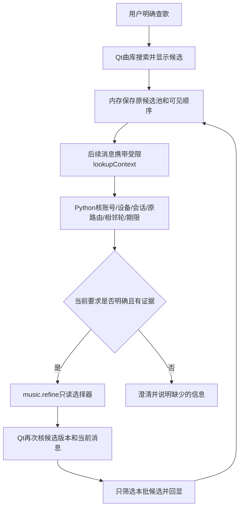

# 多轮找歌：候选上下文与只读筛选

2026-10-24。本阶段作用：用户查到歌曲后，可以接着说“第二首”“录音室版那个”“不要现场版”或明确歌手，助手继续处理这批结果，不要求重新输入歌名。

## 为什么要单独做

以前路由只拿到用户聊天和音乐任务，没有单曲搜索的真实候选。“那个”无法可靠指向一首歌；把历史歌名补进当前指令又可能继承旧播放权限。因此本阶段把“候选是什么”和“用户现在允许做什么”分开保存和验证。

## 请求怎么走

`lookupContext`保存候选集合ID、原消息和动作ID、原池及当前可见ID。最多20条，实际页面最多12条，只上传用户见过的候选；整个UTF-8上下文最多12KiB。没有Cookie、播放地址、封面凭据或自由描述，候选上下文不进入模型请求。

后台能力为`music.refine`，参数只表示序号、版本、排除版本、明确歌手或切换歌手。模型提案和程序识别使用同一校验；选择器不能添加播放、记忆、任意曲目ID或其他动作。

## 用户会看到什么

| 用户后续输入 | 行为 |
| --- | --- |
| 第二首 | 按当前真正显示的顺序选第二首 |
| 录音室版那个／换成现场版那个 | 重新从同一原始候选池筛本轮指定版本，便于纠正 |
| 不要现场版 | 只返回有明确其他版本证据的候选；未知不当作录音室版 |
| 我说的是许栀那个／直接回复许栀 | 只依据当前原话和原池中明确歌手筛选 |
| 换成另一个歌手 | 当前候选有唯一歌手时，将其排除后查看原池其他歌手；指代不唯一则追问 |
| 女声那个 | 没有可靠人声性别字段，先追问歌手或版本，不从名字猜 |

版本、排除和歌手筛选使用本轮条件重新筛原池，界面明确说明；不会悄悄累计旧过滤条件。组合条件缺少可靠证据时先澄清，不只做其中一部分便宣称满足。输入“播放第1首”属于现有独立本机明确操作，筛选本身不播放、不写偏好、不重新搜索。

## 防止旧上下文误用

- 账号、设备、会话、来源动作和候选集合必须匹配；连续筛选核验原池及上次选择器派生的可见结果。
- 原查询10分钟失效，筛选不延期；切换话题、新会话、换号或重开都不重建执行权限。没有当前候选时提示重新查找。
- 澄清可以保留同一候选，用户补充明确歌手后继续；历史加载不派发筛选或播放。
- 幂等比较包含完整上下文；相同消息不能换一批候选重跑。迟到结果不能覆盖较新查询。
- 新会话同时清旧候选视图，避免旧“播放第几首”入口继续作用于上一会话。

后台能验证来源路由、数据形状和派生关系，当前不能独立认证设备元数据确实来自网易云。没有音频分析，也没有可靠声线属性；不会据此承诺听感或完整播放权益。

## 技术栈、代码与验收

沿用C++/Qt、Python/FastAPI/LangGraph、MySQL/Redis；本机候选只是短期内存，不当作长期偏好或RAG。没有新增动态多Agent框架。MySQL继续保存消息、路由与原输入，现有事务、额度和未知请求规则保留。

主要代码：

- [Python候选契约与选择器](../backend_py/tango_backend/lookup_context.py)、[原路由来源核验](../backend_py/tango_backend/conversation_router.py)、[意图与权限](../backend_py/tango_backend/intent_routing.py)。
- [Qt候选校验](../lookupcontext.h)、[候选保存及执行](../mainwindowradio.cpp)、[会话HTTP](../conversationclient.cpp)、[本机动作日志](../radiostore.cpp)。
- [Python边界测试](../backend_py/tests/test_lookup_context.py)、[Qt流程测试](../tests/lookup_context_flow_test.cpp)、[Qt协议测试](../tests/lookup_context_client_test.cpp)、[完整链路入口](../scripts/check-lookup-context.py)。

实际结果见[最终验收证据](agent-upgrade/lookup-context-followup-verification.json)：

| 实际验证 | 结果 | 范围 |
| --- | --- | --- |
| quick | Python1113通过/25跳过，Node53通过，0失败 | 隔离接口及SQLite；数据库专属项按环境跳过 |
| 拥有者MySQL/Redis | 1664通过/60跳过，0失败 | PG专属及当前存储不适用项；迁移另建临时PG |
| native门禁 | Hosted6、MusicTask5、Routing55、Lookup27通过，0失败/跳过 | macOS真实Qt，计数含初始化/清理 |
| 新多轮完整链路 | 13场景、34交互、149最终检查全部通过 | 真Qt→HTTP→FastAPI，固定上游，151源文件和二进制前后一致，0真实模型请求 |
| 上阶段完整回归 | 原15场景、25交互、37检查全部通过 | 与最终新13题使用相同源码和二进制，旧报告不覆盖 |
| 补充专项 | 新Qt客户端36、原任务客户端193、Python相关403通过 | 与上面存在重叠，不累加；新增75项候选契约测试 |

最初12场景/31交互/135检查在其版本已通过，[首份证据](agent-upgrade/lookup-context-verification.json)原字节保留。终检发现澄清后裸姓名不能承接，先保存Python3项及Qt两类失败，再增加独立L13，不改前12题。最终13场景验收覆盖“查找→女声澄清→直接许栀”，不把第一次12题通过当作该场景已经验证。

首次失败保留：后续指代无路由3项、旧偏好误入候选分支13项、Qt上下文/新会话2项，以及本机日志白名单、协议元数据和观测过滤缺口。修复后分别复验；另保留测试夹具过早读取异步消息、编译漏头文件及新增header未登记导致旧增量对象复用等过程；补工程依赖并重新qmake后验收，不把这些误称产品语义缺陷。44份旧证据及首份本阶段报告哈希未变，新题原金标与原分数不改写。

诊断脚本现在能显示`music.refine`和`select/version/artist`等受限操作类型；LangSmith摘要允许该路由类别及固定错误码，候选内容不上传。本轮只验证模拟观测，不声称新增Cloud真实验收或Qt执行全过程已经云端可见。

App已重新编译，核实归属后正常重启本项目16382/16383后台；health/ready均200、ready=true，新增lookupContextVersion=1已核验，VSCode prepare入口退出0。关闭旧App窗口，再按F5运行新版，无需清库或重新配置密钥。启动器会拒绝复用不支持本阶段协议的旧后台。

本阶段使用固定模型、合成曲库和隔离账号；工程通过不等于真实模型语义准确率，不动旧题成绩及旧预算。原P03的女声复合要求按本阶段契约先澄清，没有把原题改成“已全部通过”。实际曲库未提供可靠版本时，界面会说明不能确认；任意复杂口语、听感与会员权益仍需分别验证。原候选超过10分钟或连续32层时需要重新查找，跨重开不自动重建执行上下文。

## 面试怎么解释

我把多轮指代落到候选集合，而不是把全部历史塞给模型。设备保留原池和当前显示顺序，后台验证来源路由、账号会话、期限和幂等输入，返回只读选择器；设备执行前再次核对候选版本。未知属性先澄清，播放权限只来自当前明确操作。用连续纠正、跨话题、换号、重开和迟到结果测试最终候选与副作用。

1. 为什么不只做聊天记忆？聊天文字没有稳定曲目ID和执行来源，不能可靠绑定“第二首”。
2. 如何防止旧播放授权被继承？筛选能力没有播放参数，缓存也不保存播放权限；当前本机播放另行判断。
3. 为什么需要后台和Qt两层校验？后台管理持久路由与归属，Qt掌握实际可见候选及播放设备；只验证一边会漏掉跨层变化。
