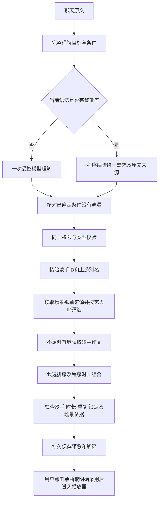

# 音乐需求：统一理解、技能路由与可核验歌单

2026-10-24。本阶段解决三个基础问题：指定歌曲能查到候选；指定歌手能浏览作品；“我在散步，推荐邓紫棋的歌曲，形成30分钟歌单”里的三个条件同时生效。此前分别识别到“找歌”或“生成歌单”仍可能漏条件，这次把目标、条件、来源和结果检查接在一起。

## 用户现在可以怎么用

| 输入 | 执行与显示 |
| --- | --- |
| 帮我查找陈奕迅的十年 | 查询指定歌手及歌名，显示带封面的真实歌曲候选；只查询不自动播放 |
| 帮我找几首邓紫棋的歌曲 | 先核验歌手，再浏览作品；“几首”使用默认展示上限12 |
| 周杰伦列8首／列出周杰伦的8首歌曲 | 把8解释为作品展示上限，不当作歌名；支持明确1至30首 |
| 给我来点周杰伦的作品，先列8首看看 | 合并作品浏览与显示数量，仍是一个只读目标；默认上限12，明确数量支持1至30 |
| 帮我找一些散步歌单 | 搜索已有歌单，点击歌单查看曲目；与生成新歌单分开 |
| 我在散步，请你给我推荐邓紫棋的歌曲，给我形成一个30分钟的歌单。 | 一个音乐任务同时保留场景、歌手、目标时长，展示预览及实际总时长 |
| 改成20分钟／换成周杰伦／保留前三首 | 修改对应条件，其余条件保留；换歌手重新检索，锁定冲突先说明 |
| 撤回 | 恢复上一版预览、条件来源及候选，下一次修改继续使用该版本的候选 |

遇到多个同名艺人会先展示候选，输入“选择歌手 1”等明确确认后继续。真实首轮中邓紫棋和周杰伦都触发了这个分支，不能保证一句话直接得到作品／歌单，也不会直接拿搜索第一项当本人。

“半小时／半个小时”统一为30分钟，“走路／边走边听”统一为散步，仍保留用户原文。其他尚不能确定的时长表达交原模型理解；同句能确定的歌手和场景不能跟着丢掉。作品数量越界、约数、范围或并列歌手先澄清，不任取一个数或把两个名字拼成一个歌手。

## 一句话概括架构

**默认一个协调音乐流程，使用明确登记的业务Skill和曲库工具；模型提出或补充理解，程序控制授权、时长计算、状态提交与结果核验。**

当前仍是Python LangGraph固定工作流和设备工具桥接。Skill不是一个独立Agent；换一个模型也不等于增加Agent。本阶段没有实现动态Supervisor或真实MCP，也没有证据证明双Agent比当前方案更好。

## 一条复合请求怎么执行

例如三条件原句会得到一个`create_playlist`目标：`scene=散步`、`artist=邓紫棋`、`targetMinutes=30`，每个字段记录本轮原文片段和`scope=task`。不是分别创建三个任务。完整可解释时直接形成brief，不让规划模型再提取一次；trace记录`understand_compiled`，调用账本不会伪造一次模型调用。

未完整覆盖时保留原模型路径，模型仍需满足程序已经确定的条件。未知字段不强行补0，也不能因为某个单位尚不支持就丢掉其他字段。反复改时长按字段更新来源，不挤掉最早确认的歌手和场景来源。

## Skill与工具怎么分工

| Skill | 正式路由能力 | 工具与执行方式 |
| --- | --- | --- |
| `song.lookup` | `music.lookup` | 可选`artist.resolve`后`song.search`；Qt执行，查询与播放授权分开 |
| `artist.catalog` | `music.artist_catalog` | `artist.resolve → artist.tracks`；显示作品，不生成或采用歌单 |
| `playlist.find` | `music.playlist_search` | `playlist.search → 用户选歌单 → playlist.tracks`；只读展示 |
| `scene.playlist` | 普通歌单的`music.task` | LangGraph编排，设备执行场景检索和作品补充，程序完成组合与检查 |
| `release.query` | 新作查询的`music.task` | 保留原歌手消歧和发行查询链路，不以普通作品冒充新作 |

注册表登记执行器、权限、工具、超时、输出和预算。正式路由验证读取同一映射，受限trace记录实际Skill名称；`GET /v1/agent/skills`可以查看登记内容。底层仍保留`scene.research`和`releases.research`两个设备研究桥接，不把注册元数据称为通用插件运行时。

场景判断来自本次需求及来源资料，不另设“场景Agent”。口味读取使用当前账号已经确认的本机摘要，作为排序的软偏好；“我在散步”仅影响本次任务。长期保存仍需单独提议和用户确认。

## 如何判断三条件真的满足

- **歌手：**先解析真实艺人ID和上游别名，候选保留`artists[{id,name}]`。按ID筛选，支持合作署名；只有相同显示名而ID不同不能混入。“邓紫棋”和“G.E.M.邓紫棋”通过实际别名及ID关联，不做任意模糊姓名匹配。
- **时长：**使用曲库毫秒时长，程序选择整首歌曲的组合并展示总时长。沿用当前容差：目标的10%，最少1分钟；30分钟目标允许27至33分钟。达不到显示未满足，时长缺失显示未核验，不承诺恰好30:00。
- **场景：**从已读取且能对应到曲目的歌单名称／标签计算依据，预览增加`scene`检查。“不适合散步”“散步不适用”等否定来源不能算命中；只查询过“散步”、AI写了适合散步的说明，都不算证据。仅从歌手目录补来的曲目可能缺乏场景依据，此时明确显示未核验，不能因歌手和时长满足就宣称三条件全部满足。
- **副作用：**搜索不自动播放，预览不自动采用，本次场景不自动写记忆。指定歌手身份解析失败时，即使降级搜索得到唯一同名歌曲也不能自动播放，必须先核验身份或让用户选择。模型或工具文字不能更改这些权限。

只读恢复按原路由和动作ID核对已完成事实，并终结本机旧动作；不重新派发旧查询、不自动播放，也不占用后续新动作的待处理位置。“不占名额”指待处理动作位置，不代表退还或重置已经消耗的模型额度。

场景来源命中证明的是文字依据，没有做音频节奏、声线、人声比例分析；听感是否适合仍需人工试听。后台验证设备回执的结构、归属、租约及版本，但没有独立认证设备提交的每个字段确实来自网易云。

## 技术栈与代码

继续使用C++17／Qt5、Python3.12／FastAPI／LangGraph、MySQL8.4／InnoDB、Redis和设备SQLite；Node.js保留为网易云适配。没有增加第二套数据库或绕过原模型传输、额度及CAS边界。

| 代码 | 本阶段职责 |
| --- | --- |
| [music_request.py](../backend_py/tango_backend/music_request.py) | 作品浏览、数量、统一条件、来源、已知单位及场景归一化 |
| [intent_routing.py](../backend_py/tango_backend/intent_routing.py)、[route_contract.py](../backend_py/tango_backend/route_contract.py) | 新能力分流、完整原句授权、模型与HTTP共用契约 |
| [music_skills.py](../backend_py/tango_backend/music_skills.py) | Skill登记及正式路由绑定 |
| [task_runtime.py](../backend_py/tango_backend/task_runtime.py)、[task_schema.py](../backend_py/tango_backend/task_schema.py) | LangGraph需求编译、身份回执、时长和场景检查、修改与撤回 |
| [conversation_router.py](../backend_py/tango_backend/conversation_router.py) | 持久歌手历史与受限Skill追踪 |
| [mainwindowradio.cpp](../mainwindowradio.cpp)、[radiodialog.cpp](../radiodialog.cpp) | 路由派发、歌手作品、歌单卡片及点击展开／播放 |
| [musictaskclient.cpp](../musictaskclient.cpp)、[neteaseclient.cpp](../neteaseclient.cpp)、[service/app.mjs](../service/app.mjs) | 设备曲库桥接、分页、真实署名与来源 |
| [test_music_requirements.py](../backend_py/tests/test_music_requirements.py)、[test_music_requirements_mysql.py](../backend_py/tests/test_music_requirements_mysql.py) | 需求、权限、正式Runtime和拥有者MySQL专项 |
| [music_intent_flow_test.cpp](../tests/music_intent_flow_test.cpp) | 正式Qt输入至Python、设备工具及播放器的隔离流程 |

新增`musicIntentVersion:1`与启动器核对，防止更新Qt后仍连接旧后台；没有清库或重置调用额度。

## 测试和当前证据

下面分开记录工程检查和真实效果，不能相加成总体准确率。原8题真实首轮完成3/8；随后身份补充诊断验证了作品和时长修改，严格结果1完成1部分完成，场景相关性仍未通过。

| 层级 | 当前已取得结果 | 能证明什么 |
| --- | --- | --- |
| 后端全量离线第二轮 | 2266通过、180跳过；早于最后补丁 | 当时版本回归，跳过不算数据库验证 |
| 撤回来源与候选修复后定向 | 500通过、28跳过 | 修改／撤回、正式LangGraph与旧冻结helper兼容 |
| 作品数量与时长／场景别名补丁后定向 | 699通过、2跳过；见私有`backend-quantity-second.txt`，早于最后语法修复 | 当时版本的数量、权限、候选指代、已知条件保真与兼容回归 |
| 最后通用语法修复后定向 | 813通过、2跳过；见私有`backend-phrase-first.txt` | 单曲量词和演唱署名、作品与数量分句合并、权限对抗、字段来源及旧冻结helper回归；不等于总体准确率 |
| 独立真实Qt隔离流程 | 14个业务用例、16项Qt检查通过，含初始化／清理 | 用户操作通过正式HTTP与设备工具；含身份解析失败禁止自动播放、只读恢复终结旧动作及新动作可继续；模型、曲库和音源为固定夹具 |
| 首轮真实执行前工程门禁 | quick Python1894通过／37跳过、Node61；独立MySQL／Redis2461通过／66跳过；native六套6／5／57／27／14／16通过 | 工程链路与边界；各套重叠不相加，跳过不算通过 |
| 首轮真实后修复与补充准备 | 聊天封面单元36通过；新身份两流Qt4通过；预算／身份Python守卫17通过；最后quick Python1911／37跳过及Node61，MySQL／Redis2478／66跳过，最终native六套6／5／57／27／14／16通过 | 零新增真实请求，不能改写原3／8 |
| 本轮真实模型及网易云 | 7／80次；8任务直接完成3项（37.5%），5项停在歌手确认；9计划轮中8已发送、1因待确认未发 | 单曲两种说法、现有歌单展示达标；作品目录、30分钟与多轮调整尚未真实完成，不能称全部通过或总体准确率 |

验收包含：三条件原句及六种分句顺序、精确单曲和歌手作品、按数量浏览、已有歌单与生成分流、改20分钟、换歌手重新检索、保留前三首、撤回后继续修改、别名和合作署名、同名不同ID、场景否定／未知、条件和转述无授权、空参数／越界／夹带播放字段拒绝、缺条件的模型brief拒绝，以及模型规划账本没有虚假调用。

首次失败均保留。扩展回归曾暴露风格词被误当歌手、候选指代优先级被覆盖、换歌手仍使用旧候选；后续数量扩展又暴露“查询”前缀短匹配及“保留前三首／第2首”误当作品浏览，已新增回归并修复，没有修改旧冻结JSON取最好分。原冲突时长用例升级为更强断言：必须明确追问且没有音乐执行。

## 真实首轮结果与残留问题

真实运行使用独立匿名曲库，没有读取你的网易云Cookie；Cloud追踪关闭。7次模型调用全部有响应（路由Flash2、任务Flash5），10763 Token，全部源码与题面前后一致，没有付费重跑。预算剩余73次不自动消耗，见[独立账本](agent-upgrade/music-intent-budget-2026-10-24.json)。

- 通过：陈奕迅《十年》两种查法，都显示5个与实际曲库署名ID2116一致的候选；现有散步歌单显示5项实际结果和可点链接。
- 未完成：普通邓紫棋作品、三种场景复合表达及周杰伦8首作品，都遇到多个同名艺人，需要用户选身份。没有读取实际作品目录，也没生成30／20分钟预览，不能把澄清当完成。
- 所有已发送轮均未改变队列或长期口味。听感、会员完整播放与总体语义准确率仍未知。

评测前两次准备检查都在业务题发送前停止，模型和曲库均0次：先修等待当前只读路由结束，再修新对话的懒创建ID检查。原准备失败及实际8题观测全部保留。后续诊断会明确包含身份选择应答，并单独授权及计分，不改原3／8。

截图还暴露聊天封面漏渲染：原测试只验证隐藏表格，聊天实际上只有文字。已补内部图片资源与共享异步缓存，歌曲与歌单显示48像素缩略图；实际聊天图片的像素、绘制、点击、恶意地址及账号隔离共36项通过，最终六套桌面回归也通过。补丁后的最终成绩单独归档，不能拿新代码改写原截图。

工程[证据](agent-upgrade/music-intent-verification.json)与真实[证据](agent-upgrade/music-intent-live-verification.json)分开。当前结论是工程主链已实现，真实业务全验收尚未完成。

## 你可以怎么验收

关闭旧App，在项目根目录运行`bash scripts/run-macos.sh`，进入音乐助手依次输入上表例句。重点看歌手是否正确、卡片是否有封面、搜索后播放器有没有自行改变、实际总时长及三个条件的核验说明。继续输入“改成20分钟”“换成周杰伦”“保留前三首”，观察其余条件和锁定曲目；如锁定曲目与新歌手冲突，应追问而不是悄悄丢锁。

目前仍有明确限制：确定性解析只覆盖完整支持的语法，自由表达仍需模型；真实曲库可用性、语义泛化、来源覆盖、听感和完整会员播放须分别验证。MCP、动态多Agent、线上质量运营和生产上线验收继续待做。

## 面试时怎么讲

**30至60秒概括：**我做的是对话音乐助手，重点解决自然语言理解后条件丢失的问题。我把目标、场景、歌手、时长和原文来源统一保存：完整支持的表达直接编译，未知部分交模型，但模型不能丢已确定条件。一个协调流程按登记的Skill调用设备曲库，先核验艺人ID，再检索场景来源和作品，最后由程序计算时长、保留锁定并输出约束检查。修改和撤回同时恢复条件与候选。评测分为权限和状态回归、真实Qt链路、真实模型曲库与人工听感，分别报告结果，不把接口成功当任务成功。

**三个常见追问：**

1. 为什么没有拆成多个Agent？这些步骤共享一个歌单目标，独立Agent会增加上下文和冲突成本；当前用确定性工具和一个协调流程即可，后续有独立研究任务且对照证明收益才拆。
2. 规则解析是不是只针对几句话？按字段和完整语法组合，测试包含顺序变化、数量及单位变化；未知表达回到模型，同时保留能确定的约束。规则不冒充开放域语义能力。
3. 怎么证明推荐正确？分别核验艺人ID、真实曲目、总时长、锁定和来源证据；听感另做人评。真实模型评测保留失败、未知、调用预算与源码版本，不能把离线替身通过率当总体准确率。

## 补充身份诊断结果（单次已执行）

两项公开诊断已编译并离线验证：作品查询后在当前候选中核对ID7763和完整名称G.E.M.邓紫棋，再选择其实际序号；三条件查询确认同一身份后生成30分钟，再改20分钟，检查同一任务、艺人和场景不丢失。固定夹具故意把目标放第二项，不能把“选择第一项”写死。

用户已新增授权身份澄清范围最多40次，运行目录`.local/music-identity-followup/identity-20261024T151930Z-bf33f936`。实际6次：路由Flash1、任务Flash5，全部响应，12176 Token；与首轮合计13／80次、22939 Token，没有重跑或额外裁判，剩余不自动消耗。

| 诊断 | 结果 |
| --- | --- |
| 作品查询＋确认当前目标候选 | 完成。12首与本次真实曲库逐项一致，实际署名含7763，封面在聊天中真实显示；未自动播放或记忆写入 |
| 三条件＋确认身份＋30→20分钟 | 部分完成。同一任务rev1→2→3，歌手与散步字段保留；30分钟实际1799996ms，20分钟1199983ms，均达时长容差。但所选曲目散步来源命中为0／8、0／5，场景相关性未核验 |

因此本次严格结果为1／2完成、1／2部分完成，不合并原8题3／8，也不是总体准确率。本次5个场景歌单每份最多读取20首，局部结果仅1首GEM《光年之外》；最终按接近目标时长组合时未选入，所选均来自歌手目录；不能把“搜过散步”或歌单标题当成每首适合散步的证明。未进行音频分析或人工试听。

实际截图还发现“场景证据不足”只在后台检查中、聊天没展示。已补到歌曲卡片后的独立“条件核验”气泡，界面39项离线测试通过。另核对到模型修改路径的当前requirementPlan没有随20分钟更新，已修正式补丁后的字段及来源同步与撤回回归；这些后续代码修复不改本次原始成绩，也未付费重跑。

证据见[补充诊断记录](agent-upgrade/music-identity-followup-verification.json)及[累计预算](agent-upgrade/music-intent-budget-2026-10-24.json)。下一步先完善场景候选召回和场景证据的选曲取舍，再用另行冻结的评测验证；不通过增加Agent数量替代真实曲库与可核验依据。

补充诊断后的最终工程验收：界面39项，后端定向334通过／29跳过；quick Python1912／38跳过及Node61，MySQL／Redis2480／67跳过，native六套6／5／57／27／14／16全部通过。App和两后台已更新并健康就绪，没有清库或额度重置。后修未付费重跑。详见[身份补充阶段](AGENT_IDENTITY_FOLLOWUP_RESULTS.md)。
