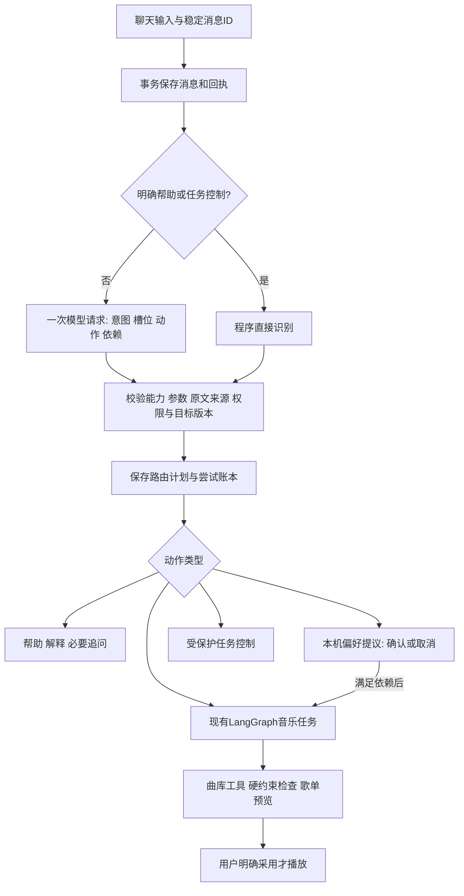

# 第 2 步：先理解需求，再选择能力

2026-10-20。对应 [升级路线](AGENT_UPGRADE_ROADMAP.md)第 2 步。本步完成工程接线和离线验收；真实模型的语义效果尚未测评。

更新（2026-10-21）：本页源码入口和技术栈已同步当前 Python＋MySQL 实现；下方验收数字仍是第 2 步交付时的历史 Node／PG 结果。迁移后的工程验证分别见 [Python 迁移](PYTHON_BACKEND_MIGRATION.md)和 [MySQL 迁移](MYSQL_MIGRATION.md)，旧代码清理见 [清理说明](LEGACY_CLEANUP.md)。

## 做了什么，为什么需要

以前后台按“有没有记住等关键词”二选一，一句话同时要求保存偏好和找歌时容易只处理其中一项。现在先得到一份结构化计划，再按能力白名单处理。**聊天框仍然只有一个，用户不用选择场景、模式或 Agent 数量。**

例如“记住我喜欢粤语，再推荐四十分钟微醺歌单，加入邓紫棋近半年新歌”，可以对应偏好提议、场景研究和发行查询三个意图，合并为一次音乐任务和一项偏好确认。偏好在聊天区内确认、编辑或取消；独立找歌继续，明确依赖保存成功的找歌才等待确认。

“你能做什么？”直接给版本化帮助，不调用模型或曲库；“为什么推荐这份歌单？”根据已有预览和来源说明，不重新生成歌单。“这首”无法定位时追问歌名或序号，不猜当前设备在播放哪首。

## 实际流程

1. **理解**：意图集合包含找歌、新作、解释、偏好、任务控制、澄清、帮助和不支持操作；槽位保留歌手、时长，动作有稳定 ID 和依赖。
2. **校验**：最多四个动作、一个音乐任务；场景和新作合并，不能同时新建两份任务覆盖。能力、来源分句、参数和依赖不合法时整份拒绝，不回退旧助手偷偷执行。
3. **授权**：模型不能凭“识别到取消”授权写操作。任务控制必须来自本轮完整命令分句，绑定服务端任务 ID 和版本；偏好只提议，最终写入仍由本机确认。
4. **执行**：Qt 仅派发白名单能力，区分“后台已接收”与“找歌完成”。旧消息、旧任务版本和迟到偏好确认不能覆盖新操作。
5. **恢复**：路由结果和尝试持久化；失败、超时或重启不自动再发模型请求。GET 只观察；重开历史不执行旧计划，不重新弹出偏好确认。

当前最多取六条之前的用户原话及当前任务摘要。原始用户消息保持不变，路由上下文单独交给任务规划，避免拆句后破坏任务幂等及会话关联。明确保存的偏好仍以本机实际值为准；“已提出偏好”不等于“已保存”。

## 技术栈与取舍

| 技术 | 本步作用 |
| --- | --- |
| Qt 5 / C++17 | 类型化计划校验、动作派发、对话内偏好确认、迟到及账号守卫 |
| Python 3.12 / FastAPI / HTTPX | 统一路由入口、严格 JSON 输出、模型超时与取消 |
| MySQL 8.4/InnoDB；SQLite 离线兼容测试 | 消息、路由和尝试账本；原子预留账号及全站额度 |
| 数据库共享模型槽位、租约、版本校验 | 防跨进程超并发；路由与已有音乐任务协调，不重复扣额 |
| Redis | 沿用账号、分钟限流及既有通知机制；不作为完成状态的权威 |
| Python LangGraph | 继续执行音乐研究、工具、预览和检查点；语言迁移没有增加专业 Agent |

能力注册表登记版本、输入输出、权限、确认要求、依赖、超时、模型预算和验收点。这是应用能力注册表，**尚不是 MCP 工具链或动态多 Agent**。确定性时长计算、去重、权限和数据库写入继续由程序负责。

明确帮助和控制的路由请求为零次模型调用；其他自由表达最多增加一次意图模型请求，之后沿用音乐任务原预算。这个版本增加了理解层的调用开销，不能声称整体延迟或推荐质量已经优于旧版。失败和未知的已预留尝试保留在账本中；数据库故障不把同一消息自动重调。

## 代码和接口

- [intent_routing.py](../backend_py/tango_backend/intent_routing.py)：直接路由、模型契约、参数与操作授权守卫。
- [capability_registry.py](../backend_py/tango_backend/capability_registry.py)：四项能力及版本、权限、预算等元数据。
- [conversation_router.py](../backend_py/tango_backend/conversation_router.py)：上下文组装、付费预留、完成校验与失败处理。
- [conversation_route_store.py](../backend_py/tango_backend/conversation_route_store.py)：路由、尝试、幂等、租约及 MySQL／兼容数据库事务。
- [conversationclient.cpp](../conversationclient.cpp)、[mainwindowradio.cpp](../mainwindowradio.cpp)、[radiodialog.cpp](../radiodialog.cpp)：单次路由、只读观察、动作执行及内联确认。
- [task_runtime.py](../backend_py/tango_backend/task_runtime.py)：保留原消息锚点并接入会话上下文；等待同账号路由槽位。

新增 `POST /v1/conversations/:conversationId/messages/:messageId/route` 开始本轮理解；同路径 GET 只读结果。`GET /v1/agent/capabilities` 查看注册能力。路由完成表示计划就绪，不代表音乐任务或偏好已经完成。

## 第 2 步交付时的测试与结果（历史 Node 版本）

完整数字、源码哈希、可复核日志和首次失败见 [第 2 步验证记录](agent-upgrade/step2-verification.json)。使用临时数据库、隔离 PG / Redis、假模型和假曲库，没有调用真实模型或真实曲库。

最终后台与存储回归 **668/668，零失败、零跳过**；五套 Qt 验证 **72 项功能通过**（含初始化和清理为 82/82）。这些是工程用例计数，不是 668 个用户任务。

- 原生 Qt → 真实 Node → 路由 → 偏好取消／确认 → 音乐任务 → 本机模拟曲库 → 40 分钟预览链路通过；锁定修改、重启观察、采用和合成静音 WAV 回归也通过。
- HTTP、纯契约、真实环回模型 transport、额度、并发、账号设备隔离、引用否定、错误计划、超时和取消均有回归。
- 两个真实 PG 后台实例验证：路由占模型槽位时，原任务等待且不新增账单；释放后继续，等待中取消也能退出。
- 故障注入验证数据库两次完成写入均失败后，本机占位会释放；旧消息保持未知且不重调，新消息可以继续。

独立审查实际发现并修复了“否定句／截取继续解释也可能授权控制”和“数据库故障遗留本机占位”两项问题。首次编译错误、测试夹具错误和修复记录保留，不挑最好的一次冒充首次结果。

这些结果证明工程链路和已知边界；**不能换算成真实模型的任务完成率或总体准确率**。[39 个开发场景](agent-upgrade/step2-acceptance-cases.json)已曝光，用于开发验收设计，尚未整体执行真实语义测评，也不是独立新题。历史 499/500 评测预算未增加或消耗。

## 当前限制

真实 Qwen 的意图漏项、槽位准确率、指代和新话题判断仍须冻结样本后实测；保守命令语法也会拒绝部分正常表达。短期上下文有六轮上限，长期偏好的权威记录仍是本机摘要，第 5 步再做条目治理。任务及路由账本保存当时传入的上下文用于追溯；清空本机偏好不等于删除历史聊天、任务或路由快照，历史删除和派生失效尚需该阶段补齐。

待确认动作的本机派发状态不跨重启自动续跑；恢复历史只展示。MCP、动态 Supervisor、专业多 Agent、检索效果对照和线上聚合监测仍在后续阶段。第 2 步交付当时新增路由表尚未加入 SQLite→PG 工具，工具会保守拒绝；后续 [MySQL 迁移](MYSQL_MIGRATION.md)已覆盖路由表并完成本机数据切换，旧 SQLite→PG 工具已归档。

## 面试怎么讲

> 我在持久会话与音乐任务之间加了统一路由。明确操作直接处理，自由表达由模型输出意图、槽位和动作，再由程序校验能力和授权。一句话可以组合偏好确认与找歌。路由调用和额度在数据库事务中预留，未知结果只读恢复；Qt 只执行白名单计划，版本变化和迟到确认会被拒绝。测试包含原生端到端、跨进程并发和故障注入，真实模型质量单独评测。

1. **为什么用规则加模型？** 规则处理明确操作、权限和硬边界；模型处理自由语义。模型输出只是提案，不是执行权限。
2. **路由和 Agent 有什么区别？** 路由决定用哪项能力，现有 LangGraph 任务才负责持续工具执行；多次调用模型不等于多个自主 Agent。
3. **如何避免超时重复收费？** 消息稳定 ID、持久尝试、事务预留和未知终态；查询不重放。保守预留不等于供应商实际金额账单。
4. **为什么不能给准确率？** stub 只证明已给定提案能被正确校验和派发。真实语义效果需要独立输入、人工金标、冻结版本、明确分母与预算。

下一步按路线接真实 MCP 工具发现与调用链，保留现有曲库适配器、Cookie 本机隔离、权限和预算；先证明标准连接真实可用，再讨论动态专业分工。
