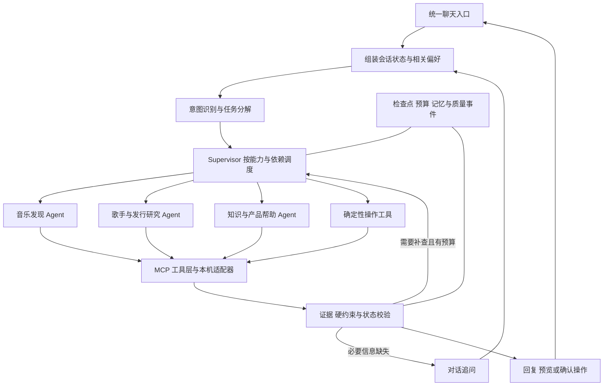

# 探歌音乐 Agent 升级计划与学习路线

2026-10-24 当前工程优先项：先完成 [待确认动作恢复](AGENT_PENDING_ACTION_RECOVERY.md)，再做独立端到端评测、反馈与告警回归、生产备份恢复及部署验收。原 MCP 与动态 Supervisor 路线仍保留为待实施，不能把恢复改造写成新增多 Agent。
更新日期：2026-10-21。最初路线制定基线为 `bb6d0bc`，当前进度以 [开发交接](DEVELOPMENT_PROGRESS.md) 为准。

产品方向已确定：继续深耕探歌 Tango 音乐助手，以统一对话完成找歌、新作查询、结果解释、连续修改和偏好管理。用户通过自然语言表达需求，系统负责识别意图、选择能力、执行工具和处理失败。项目深度通过实际任务效果、失败处理与工程证据体现。

当前技术栈为 C++/Qt＋Python FastAPI/Python LangGraph＋MySQL 8.4/Redis；客户端 SQLite 和网易云 Node 适配保留，旧 JS AI 后台已撤出。已实现的流程与代码统一见 [当前 Agent 设计](AGENT_DESIGN.md)，数据库迁移见 [MySQL 说明](MYSQL_MIGRATION.md)。语言和存储迁移不视为第 3 步 MCP 或后续目标已经完成。

本文是后续实施依据。以下目标尚未整体实现；历史架构图和历史测试只能说明对应版本，不能作为新架构已完成的证明。

2026-10-21 起，每步实施同时遵循 [Harness 工程规范](HARNESS_ENGINEERING.md)，更新 [五类能力清单](HARNESS_STATUS.json) 与 [开发交接](DEVELOPMENT_PROGRESS.md)，运行对应层级门禁。规范、结构检查和 CI 配置不替代产品能力验收；第 3 步仍按 [MCP 执行计划](exec-plans/active/mcp-tools.md) 待实施。

## 一 共同确认的要求

1. 一个主要聊天区，底部固定多行输入框；对话、追问、工具进度、歌单和确认操作放在同一会话内。
2. 去掉常驻场景、模式和 Agent 策略选择项，由系统识别需求；保留与当前消息相关的必要身份澄清、偏好确认和采用操作。
3. 支持简单任务直接处理、缺信息时必要追问、复合需求分解和动态路由，不要求用户决定使用几个 Agent。
4. 做实有界 Agent loop、MCP 工具、多轮记忆、长期偏好、失败恢复和检索优化；每项说明解决的问题及适用范围。
5. 建立在线质量监测和端到端评测，对比方法时同时报告效果、延迟、调用量与成本。
6. 分步骤实施。每完成一个可验收步骤，向用户讲清流程、代码、测试、结果、局限和面试追问，并更新本文件。
7. 不为增加角色数量而拆 Agent；不把框架安装、注册表或测试数量当成任务效果。
8. 模型密钥留在后台；网易云 Cookie 与播放授权继续留在用户设备，账号、任务和偏好相互隔离。

## 二 当前基础与真实缺口

| 方面 | 已有基础 | 本次要补齐 |
| --- | --- | --- |
| 对话入口 | 第 1 步已接入持久会话、多行输入及任务／偏好统一记录 | 后续统一语义路由与上下文选取；内部暂桥接两条旧执行链路 |
| 意图理解 | 第 2 步统一意图、槽位和有界能力计划，接通内联偏好确认及任务控制 | 真实模型语义效果、更多上下文与开放表达仍需独立验收 |
| 执行与分工 | LangGraph 固定阶段，有界补查；全局配置单或双研究角色 | Supervisor 按任务和能力调度，结果不足时针对原因调整计划 |
| 工具 | 场景与新作两个自定义 Skill、本机执行与结果校验 | 稳定工具契约、真实 MCP client/server 调用链和统一错误语义 |
| 记忆 | 结构化任务状态、待澄清来源、歌单版本；本机确认式长期偏好 | 会话内跨意图连续性、相关偏好检索、冲突与删除生效验证 |
| 检索 | 条件联合查询、有限补查、证据合并与来源标签验证 | 召回诊断、原因对应的修复策略与有标注的相关性评测 |
| 治理 | MySQL 8.4 检查点、CAS、租约、幂等、预算账本、Redis/SSE；旧 PG 适配保留 | 保留底座，补充路由与质量事件、聚合指标、告警和反馈闭环 |
| 评测 | 离线契约、故障注入、真实模型有限样本与已知修复回归 | 新架构独立题、多轮任务、方法对照及清楚的统计口径 |

当前源码入口：[任务运行时](../backend_py/tango_backend/task_runtime.py)、[任务模型](../backend_py/tango_backend/task_model.py)、[意图路由](../backend_py/tango_backend/intent_routing.py)、[界面分流](../mainwindowradio.cpp)、[助手界面](../radiodialog.cpp)、[本机工具](../musictaskclient.cpp)、[长期偏好](../radiostore.cpp)。

## 三 目标流程与技术边界

这是目标设计。当前采用 Qt/C++ 客户端、Python FastAPI＋Python LangGraph 后台、MySQL 8.4＋Redis；保留已有曲库与播放链路。旧 Node/PG 记录只说明历史版本，本次存储迁移不等于后续 Agent 能力已经完成。

- **会话与任务分开**：conversation 承接多轮交流，一个会话可以包含多个 task；turn 有稳定消息 ID、提交回执和目标任务，避免聊天记录与某一次歌单状态绑定。
- **意图与执行分开**：路由输出意图、参数、待确认信息、子任务和依赖。模型提案经过程序校验，不能凭路由结果越过授权执行写操作。
- **按能力分工**：音乐发现、发行研究、知识与帮助是候选专业角色。各自有上下文、工具权限和结果契约；只有确有独立研究任务时才派发。时长计算、去重、锁定校验和记忆存取使用普通工具。
- **知识回答有来源**：产品帮助使用版本化文档；需要最新事实时取得可核验资料。没有依据时说明未知。知识检索是否需要向量索引，取决于实际语料和检索对照。
- **工具访问有边界**：MCP 负责标准连接，应用负责账号权限、预算、取消、结果校验和用户确认。接入时锁定协议与 SDK 版本，验证对应版本的发现与调用流程。
- **状态有权威来源**：MySQL 保存任务与操作状态；Redis 做缓存、限流和通知。缓存与通知不决定任务是否成功，不绕过检查点与版本校验。
- **记忆由用户控制**：先接好当前本机偏好。若后续需要跨设备，另做服务器存储与迁移；展示迁移内容和用途，由用户选择，不自动上传旧偏好。删除需要使缓存、检索及后续上下文失效。
- **监测贯穿执行**：从第一步记录消息、任务、路由、工具与结果关联事件。后续再补聚合、告警和抽样复核，避免最后才补日志。

贯穿验收的示例：

> 记住我喜欢粤语 R&B。今晚喝酒听四十分钟，加入邓紫棋近半年的新歌，前三首不要换。

系统应识别偏好提议、场景研究、发行核验和现有歌单锁定；没有现有歌单时澄清“前三首”指什么。独立研究结果统一合并，程序检查约束，长期偏好等用户确认后保存。后续“少点人声”“为什么推荐这首”“撤回刚才的修改”继续留在同一会话。

## 四 实施顺序与每步学习内容

每一步先确定输入、输出和验收，再改实现；该步完成后立即汇报。常规可逆修改沿已确定范围继续推进，不把每一步变成重复审批。范围变化、额外付费或数据迁移需要单独说明。

### 第 0 步 冻结基线与验收协议

**做什么**：记录源码版本、现有接口和用户可见行为；建立回归集、独立题保留规则、指标口径及结构化事件契约。开发题与最终独立题隔离，最终题不用于调参。质量门槛在正式测评前冻结。

**验收**：每个要求能对应到测试或人工判据；模拟、真实模型、真实曲库和人工评价分开；测试可以失败退出并保留失败。新增行为不得破坏账号隔离、真实 ID、确认写入、取消和预算保护。

**面试追问**：

- 为什么不能把几百个工程测试通过率叫作 Agent 准确率？答题重点：测试对象、统计分母、任务分布和外部有效性不同。
- 为什么要冻结题目和版本？答题重点：防止调参污染、保留失败、支持复现；修复回归与独立验证分开。

### 第 1 步 统一会话与聊天界面

**做什么**：统一 conversation、turn、task、消息回执与确认操作契约。把找歌、偏好提议与回复接入同一可恢复会话，消除两条处理链路刷新造成的记录覆盖。偏好规则暂迁到后台作为兼容桥接，语义路由在第 2 步实现。界面改为主要聊天区、底部多行输入框和对话内结果卡片，移除常驻模式选择与反馈条。

**流程**：输入 → 带稳定消息 ID 提交 → 服务端校验并幂等持久化消息及回执记录 → 返回接收确认 → 展示执行状态或回复。收到确认后仅清理该消息对应且未再编辑的草稿；提交结果不明时按同一 ID 查询，不另建消息重复发起。

**验收**：Enter 发送、Shift+Enter 换行、中文输入法不误发；重复发送与失败不丢草稿；偏好回复不被任务刷新覆盖；重开会话可恢复；换号不混入旧消息；生成预览不自动播放。

**面试追问**：

- 为什么 conversation 和 task 需要分开？答题重点：聊天可跨意图和任务，任务有独立执行状态与生命周期。
- 请求超时能否直接重试？答题重点：超时不等于未提交；消息级幂等、回执查询、迟到响应与草稿恢复。

### 第 2 步 统一意图与能力路由

**做什么**：建立音乐推荐、新作查询、结果解释、偏好提议、任务控制、澄清与帮助等意图契约，支持一轮多个意图。登记能力版本、输入输出、依赖、权限、超时、预算和验收用例。

**流程**：上下文组装 → 输出类型化意图与子任务 → 校验参数和允许的能力 → 直接处理、追问或交给执行器。当前轮明确要求优先，旧上下文不能重新授予写入权限。

**验收**：简单请求不无故进入多 Agent；缺歌手时追问歌手，已有足够信息时直接查询；复合要求不漏项；否定、引用、指代和话题切换正确处理。报告路由与参数错误，不能只看最终是否生成歌单。

**面试追问**：

- 规则路由和模型路由如何分工？答题重点：明确操作与权限用程序守卫，自由表达与复合语义交模型，输出仍校验。
- 为什么不能按句子长短判断复杂度？答题重点：缺失参数、依赖、歧义和副作用才决定执行路径。

### 第 3 步 接通真实 MCP 工具链

**做什么**：先稳定曲库搜索、歌单读取、歌手解析和发行查询工具的 schema、错误码及取消语义，再实现 MCP server/client。复用本机音乐适配服务，保留 Cookie 本机隔离。

**流程**：按锁定版本发现能力 → 列出工具 → 调用工具 → 真实适配器执行 → 校验结构化结果 → 提交检查点。记忆写入和播放采用继续保留确认规则。

**验收**：实际 MCP client 能发现并调用工具；不是只安装 SDK。验证未知工具、错误参数、版本不兼容、超时、取消、越权和大结果限制；有真实曲库联通证据，离线模拟结果另列。

**面试追问**：

- MCP、普通 HTTP 接口和 Function Calling 分别解决什么？答题重点：标准工具连接、业务传输、模型提出调用意图；三者不互相替代。
- MCP 是否自动保证安全？答题重点：协议不替代账号权限、工具白名单、凭据隔离和写入确认。

### 第 4 步 有界 Supervisor 与动态专业分工

**做什么**：Supervisor 基于子任务、能力和依赖派发专业 Agent；每个角色有独立上下文、工具范围、结果和停止条件。统一任务预算、取消信号和版本，支持对缺失证据的局部重规划。

**流程**：计划 → 执行可运行子任务 → 观察结果 → 检查约束与证据 → 完成、补查、追问或停止。独立研究可并发；依赖和共享写入按顺序处理。实际模型并发须遵守账号与全局额度。

**验收**：先验证单 Agent 完整闭环，再验证复合任务分工；工具失败不会无限循环；旧版本结果不能合并；中断后从业务检查点继续，不盲目重放不确定的付费调用。保留固定单 Agent 作为对照，Agent 数量不作为通过标准。

**面试追问**：

- 为什么某个任务需要多 Agent？答题重点：独立信息研究、上下文与工具隔离，并用对照证明收益及成本。
- 如何处理循环和并发冲突？答题重点：步骤预算、无进展检测、幂等、CAS、租约与统一提交。

### 第 5 步 会话记忆与长期偏好治理

**做什么**：短期记忆保存已确认条件、待澄清项、证据引用与当前任务；历史压缩保留来源和关键约束。长期偏好按条目检索，记录来源、适用范围、确认时间与版本，支持确认、修改、逐项删除及清空。

**流程**：区分本次场景与长期要求 → 提出偏好变更 → 用户确认 → 保存并产生回执 → 后续按相关性读取。删除或撤销后，使旧缓存和派生上下文失效。跨设备迁移单独验收。

**验收**：临时饮酒场景不形成长期画像；“不要记住”“只删这一项”不误触发；新偏好覆盖冲突项，保留无冲突项；换号隔离；删除后后续推荐不再引用；上下文截断不丢硬约束。

**面试追问**：

- 记忆为什么不等于把全部聊天放进向量库？答题重点：作用域、来源、权限、冲突、时效和删除比存储形式更重要。
- 短期恢复和长期偏好有什么区别？答题重点：任务进度与跨任务习惯的生命周期、授权及检索方式不同。

### 第 6 步 诊断驱动的检索改进

**做什么**：记录查询、来源、候选数量、去重和过滤原因。区分上游异常、空召回、过滤后为空、身份歧义、来源不相关和证据不足，再决定改写、同义词、分解查询、分页、拓宽来源或追问。

**验收**：上游故障不误报没有歌曲；补查保留已有证据并避免重复路线；未经用户允许不放宽硬约束。以人工标注候选池比较原查询与改进方案，报告池内 Recall@K、Precision@K、NDCG@K、延迟与请求量；不得称为全网易云召回率。

**面试追问**：

- 召回少和排序差怎么区分？答题重点：相关候选有没有进入候选池，以及进入后的位置，分别测量。
- 为什么不直接增加查询次数或使用向量库？答题重点：先定位瓶颈，比较召回收益、数据条件、延迟和成本；有真实语料时才评估混合检索。

### 第 7 步 在线质量监测与反馈闭环

**做什么**：汇总前面已接入的结构化事件，形成路由、工具空结果、过滤、补查、约束、耗时、Token、费用、采用和反馈指标。配置失败趋势与异常调用告警；必要时抽样异步 critic，保留人工裁决。

**验收**：可从一个失败会话定位具体阶段与原因；明确区分技术成功、生成预览、用户采用和实际播放；缺少用户反馈记为未知。日志不含 Cookie、密钥、会话令牌或不必要原文。critic 不替代金标，不未经验证自动改变线上策略。

**面试追问**：

- 有日志为什么还需要质量监测？答题重点：关联事件、指标聚合、趋势、告警和反馈，才能发现系统性退化。
- 为什么不让另一个模型给全部回答打分？答题重点：评审偏差、相关性、成本，以及与人工和确定性指标的校准。

### 第 8 步 独立端到端评测与发布判断

**做什么**：在前面各步回归通过后，冻结独立新题、允许路由、硬约束、证据要求和终态。目标题集覆盖单轮、3–6 轮修改、混合动作、记忆冲突与删除、工具故障、注入越权、取消和恢复。候选规模为 60–100 个任务，最终规模按调用估算与新增预算确定。

**对照**：相同题目、候选快照、工具与费用边界下，比较固定流程、单 Agent 和自适应路由。人工质量评价对方法标签盲评；真实在线检索须注明时间与数据变化，不能伪称完全相同输入。

**报告**：

- 严格任务完成率：全部必要要求满足且终态正确的任务 / 全部已选任务；失败、中断和待核验分别列出，保守口径不把待核验计成功。
- 意图和路由：意图集合与槽位正确性、macro-F1、漏子任务和不必要多 Agent；合理多个路由用允许集合标注。
- 证据和检索：事实支持、硬约束违约、标注池内召回与排序；来源标签命中和人工听感分别统计。
- 记忆和恢复：正确命中、错误注入、删除生效、跨用户泄漏、恢复后重复执行。
- 效率：每任务调用量、Token、费用及 p50/p95 延迟；注明样本量、分母、版本与置信区间。

**验收**：保留原始脱敏记录、失败、源码版本和预算台账；不重跑取最好值，不混加不同版本分数。账号泄漏、伪造 ID、未经确认写入等关键安全回归不得带病发布；效果与容量须达到正式测评前冻结的门槛，未达到则继续修复和独立复测。

**面试追问**：

- 如何证明多 Agent 比单 Agent 有用？答题重点：配对对照、同等资源、失败归因与成本，而非选成功案例展示。
- 能不能给一个总体准确率？答题重点：定义任务与目标用户分布，报告主指标及分项、未知、样本与统计不确定性。

## 五 预算与历史成绩的使用

截至本文记录，[累计预算台账](agent-evaluation-cumulative-budget.json) 为历史授权 500 次、已用 499 次、剩余 1 次。失败、超时及已发起但结果不确定的请求同样计数。本计划不构成新的付费授权，不自动使用剩余额度。

文档、离线契约、模拟工具、故障和本机工程回归可以继续。新一轮真实模型评测应先完成离线准备、冻结协议并估算调用数，再取得新增预算；模型评审器的调用也计入。

历史 [v2 评测](agent-evaluation-summary-2026-10-19.json) 的 34/53 任务完成，以及 [v7 回归](agent-repair-v7-summary.json) 的 2/2 已知问题通过，均保留原适用范围。Redis/存储工程测试通过数量不能并入模型任务完成率，不能用历史成绩声明本计划已经验收。

## 六 每一步向用户交付的固定说明

每完成一个可验收步骤，汇报并记录以下内容：

1. **改了什么，解决什么问题**：给一个修改前后的具体用户例子。
2. **请求怎么走**：从输入到路由、工具、状态变化和最终结果，解释为何采用这条路径。
3. **代码在哪里**：主要文件、接口、状态与契约；给可定位链接。
4. **怎么验证，结果如何**：实际执行命令、用例、分母、通过/失败/跳过和记录；标明是否调用真实模型、曲库或音频。
5. **还不能证明什么**：已知局限、未完成项、成本与风险，不用推测填补结果。
6. **面试怎么讲**：30–60 秒概括、2–4 个追问、回答要点，以及为何没有采用备选方法。按用户对术语的熟悉程度解释。
7. **下一步做什么**：依赖、验收目标，更新下表；常规进展不重复索要批准。

面试回答只讲实际完成并有证据的内容。尚未验证的收益明确标注，不能提前把本路线中的技术写成已经掌握或已经上线。

## 七 实施进度

用户要求先完善上线前的登录、内测准入与账号防滥用。本轮已实现密码眼睛、确认密码、内测码原子注册、账号日／累计额度和分层限流；原先基于 PostgreSQL 的事务、账号隔离和额度保护已迁为 MySQL 8.4＋Redis，实际测试和操作见 [内测账号说明](BETA_ACCESS_AND_QUOTAS.md)。它是第 2 步前的产品与后端保护，不计作语义路由或 Agent 效果提升。

| 步骤 | 状态 | 完成证据与下一动作 |
| --- | --- | --- |
| 方向与路线记录 | 已完成文档记录 | 本文、README 入口、根目录 AGENTS.md；未修改功能代码 |
| 0 基线与验收协议 | 已完成第 0 步工程与契约验收 | [阶段说明](AGENT_STEP_0_BASELINE.md)：冻结来源与指标定义，26 个开发场景、9 类质量事件、实际回归及首次失败均留证；新架构效果和数值发布门槛待校准 |
| 1 统一会话与界面 | 已完成工程验收 | [交付说明](AGENT_STEP_1_CONVERSATION.md)：统一持久消息、回执、任务关联、多行输入；找歌→确认偏好→修改→重启链路通过，真实模型效果与原生输入法候选窗人工体验未测 |
| 2 意图与能力路由 | 已完成工程验收，真实模型语义效果待评测 | [交付说明](AGENT_STEP_2_ROUTING.md)：类型化多意图、能力白名单、内联确认、只读恢复和账本；后台 668/668、Qt 72 项功能通过，未调用真实模型，39 个开发场景尚未整体测评 |
| 3 MCP 工具链 | 待实施 | 稳定工具契约、锁定协议版本、接通真实适配器 |
| 4 Supervisor 与分工 | 待实施 | 单 Agent 闭环后加入按能力调度，保留对照 |
| 5 记忆治理 | 待实施 | 先确认本机连续性与删除生效，云端迁移单独选择 |
| 6 检索优化 | 待实施 | 先诊断和标注，再比较修复策略 |
| 7 在线质量监测 | 待实施 | 早期事件贯穿，至本步补齐聚合、告警与抽样复核 |
| 8 独立评测与发布判断 | 待实施 | 冻结未见题和新预算，按结果决定是否可发布 |

2026-10-21 存储迁移补充：当前 MySQL 8.4/InnoDB 使用显式事务、行锁、版本 CAS、共享模型槽位和统一额度账本，Redis 保留缓存、限流与进度通知。PG 源库及备份保留，不自动回退；客户端 SQLite 不迁走。本步是工程底座迁移，隔离验证和切换边界见 [MySQL 迁移说明](MYSQL_MIGRATION.md)，不增加真实模型完成率或准确率样本；主线下一步仍是 MCP。

用户另确认 [多模型路由阶段](MODEL_ROUTING.md)：先支持 Flash／Plus 的后台配置、按用途选择、调用审计及恢复校验，再用真实独立题比较收益。它作为基础能力补充单独交付，不把 MCP、动态多 Agent 或真实效果标为完成。

进度只依据实际实现和验证更新。“开始实现”不等于“验收完成”；失败与未完成项持续保留。

2026-10-23 当前插入 Step 2 补充验收：[对话开发校准](AGENT_CALIBRATION.md)。先用 10 个开发任务/17 轮校准执行器和现有理解链路，真实模型预算与人工结果单列，再继续 MCP。此校准不是第 8 步的独立新题，也不将后续多 Agent、记忆治理等标为完成。

真实执行结果见 [本轮分析](AGENT_CALIBRATION_RESULTS.md)：38 次 Flash，后台契约 6/10，模型意图可验证匹配 9/12。当前先定位被拒提案、澄清层级与条件化金标，并完成用户人工复核；不是整体效果验收通过，MCP 和动态 Supervisor 仍未实现。
