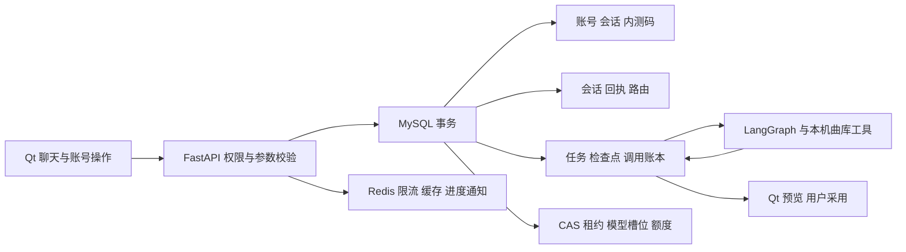

# MySQL 迁移：作用、流程与验证

更新：2026-10-21。本步把当前 Python 后台的默认共享存储从 PostgreSQL 改为 **MySQL 8.4/InnoDB＋Redis**，客户端仍为 Qt/C++。作用是完整保留账号、聊天、Agent 任务和防滥用机制，同时完成用户选择的数据库技术栈；更换数据库本身不会提高推荐准确率。

本机已完成切换：17 张数据及审计表、31 条记录逐表核验一致，旧 PG 已备份并停止。普通入口 `16382` 和开发入口 `16383` 均返回 `storage: "mysql"`、`rateLimiter: "redis"`，就绪检查通过。账号、额度和调用账本已保留，开发免登录与能力接口正常。本轮未调用真实模型。完整证据见 [验收记录](agent-upgrade/mysql-migration-verification.json)。

MySQL 能满足当前账号、会话和任务事务的需要。PostgreSQL 也适用于普通业务系统，选择它与是否使用 RAG 没有必然关系；本次调整依据是项目当前需求与维护者的技术选择，没有宣称数据库性能提升。

## 实际流程



例如用户重复提交同一消息，后台按原消息 ID 查幂等记录；不会重复建任务。两个 worker 同时处理同一账号时，用事务行锁、共享模型槽位和版本 CAS 决定谁能继续。模型调用前在同一事务中保存尝试并预留账号及全站额度，失败或未知的已发起尝试仍计数；数据库事务不跨越外部模型请求。

MySQL 是任务状态和额度的权威来源。Redis 负责短期限流、白名单工具元数据缓存及阶段版本通知；缓存或通知故障时按既定降级规则读取数据库，不能因此放开新 AI 请求的安全限流。Qt 的历史、收藏、长期偏好及网易云 Cookie 继续留在本机 SQLite／账号空间。

## 用了什么技术，为什么这样做

- **asyncmy 异步连接池＋InnoDB**：数据库操作不阻塞 HTTP 事件循环，事务内使用同一连接；嵌套事务用 savepoint，取消会回滚。
- **READ COMMITTED＋显式行锁**：账号、模型槽位和额度按统一顺序加锁；`music_storage_locks` 行锁随事务结束释放，不使用连接级 `GET_LOCK`。
- **CAS、epoch、租约与幂等账本**：旧 worker 的迟到结果不能覆盖新状态；重启只恢复业务检查点，不自动重发结果不明的付费请求。
- **原生 JSON＋BIGINT 毫秒时间**：沿用既有表名、JSON 字段与摘要。`utf8mb4_0900_bin` 使用 NO PAD 语义，避免 ID 的大小写或尾空格被误判为相同。
- **独立初始化 DDL**：MySQL DDL 会隐式提交，建表在服务就绪前完成，不能把建表包装成可回滚的业务事务。业务 SQL 显式分 MySQL 分支，不正则改写 `RETURNING` 或 `ON CONFLICT`。

账号继续使用原 scrypt 密码格式、成功登录后 CAS 升级旧哈希、随机会话令牌的 SHA-256 摘要、默认内测码注册及每账号额度。开发免登录仍需要真实 loopback 连接与本机私密能力令牌，使用独立开发身份。

## 代码与接口

| 位置 | 职责 |
| --- | --- |
| `backend_py/tango_backend/storage_db.py` | `execute/fetchone/fetchall/transaction/lock_key` 异步数据库边界 |
| `backend_py/tango_backend/migrations/001_initial_mysql.sql` | 18 张 InnoDB 表：16 张业务表、旧导入审计表及共享事务锁表 |
| `backend_py/tango_backend/store.py`、`mysql_store.py` | 账号、密码、应用会话与每日消费 |
| `backend_py/tango_backend/mysql_task_store.py` | 任务 CAS、租约、模型槽位和调用账本 |
| `backend_py/tango_backend/conversation_store.py`、`conversation_route_store.py` | 持久聊天、路由尝试与只读恢复 |
| `backend_py/tango_backend/account_quota.py`、`invite_store.py` | 额度和内测码的事务保护 |
| `backend_py/tango_backend/ensure_storage.py`、`storage_profile.py` | 启动依赖与显式选择当前存储 |
| `backend_py/tango_backend/migrate_mysql.py`、`admin.py` | 离线迁移、发码与提额维护 |

本机开发未安装数据库工具时执行 `brew install mysql@8.4 redis`，再执行 `uv sync --project backend_py --python 3.12 --frozen`。启动器的 `ensure_storage` 只管理项目独立实例，不操作 `brew services` 或系统默认库。

Qt 的 HTTP/JSON 和 SSE 合同保持兼容。当前启动配置默认 MySQL；本机私有配置位于 `.local/mysql-v1/storage.env`，受保护的 `active.json` 决定何时切换。`/health` 的 MySQL 模式应返回 `storage: "mysql"`，就绪检查另行检查 MySQL 和 Redis。

## 迁移与回滚边界

迁移需要停掉所有源后台写入。维护者显式指定 PG 源配置与空 MySQL 目标配置；工具检查已知表列、活动任务和目标是否为空，执行时先创建私有 PG 备份，再在一致源快照下按依赖导入、核对逐表行数和内容摘要。任何不支持的表列、活动状态或摘要不符都失败；不会静默忽略。默认计划不导入业务行，但可能初始化空目标表；不会自动切换 profile。

```bash
# 只核验计划；配置路径由维护者显式指定
uv run --directory backend_py python -m tango_backend.migrate_mysql \
  --source-env /私密路径/pg.env --target-env /私密路径/mysql.env
# 执行时另加 --execute --backup-directory /私密路径/backups --report /私密路径/report.json
```

完整核验与停机切换由维护者完成，之后才启用 MySQL 的 `active.json`。PG 源库与备份保留，不自动清除。**MySQL 产生新写入后，直接改回旧 PG 会丢失增量**；回滚必须先停写、核对差异并显式处理增量。当前没有自动双写、在线迁移或自动反向同步。

## 做了哪些验证

自动测试只使用自建临时 MySQL 8.4、PG、Redis 和合成账号，不把真实用户库当测试数据。实际迁移单独读取本机旧库、创建私有备份并核对目标；没有发起真实模型、网易云或音频请求。

| 专项 | 已确认结果与范围 |
| --- | --- |
| MySQL 账号与事务底座 | 8/8 通过；真实 MySQL：18 表引擎与排序规则、READ COMMITTED、Node 旧密码向量升级、跨实例会话、内测码并发消费与失败回滚、原子额度、savepoint、取消回滚、事务锁释放、JSON/CAS、独立开发身份与显式管理 CLI |
| MySQL 任务存储 | 18/18 通过；任务 agent 的真实临时 MySQL 专项，覆盖任务与请求幂等、所有权、租约、模型槽位、调用／额度和恢复边界 |
| PG→MySQL 离线迁移 | 15/15 通过；独立临时 PG 和 MySQL：17 张数据／审计表非空摘要一致、旧源无审计表兼容，以及活动／不确定调用状态拒绝、只读计划、目标非空拒绝、摘要失败整批回滚与报告路径保护 |
| 旧 SQLite／PG 底座兼容 | 23 通过、1 不适用跳过；保留密码、会话、旧数据互通与管理工具行为；跳过项仅为 SQLite 不适用的 PG 分布式用例 |
| 全量工程回归 | **656 通过、0 失败、30 跳过**，29.08 秒。含真实 MySQL、Redis、迁移、Qt HTTP 贯通及共享逻辑／SQLite 对照；28 项 PG 兼容项在独立环境另测，2 项 SQLite 不支持分布式能力 |
| PG 兼容路径 | **56 通过、0 失败、5 跳过**，7.82 秒；3 项 MySQL 已在主套件执行，2 项 SQLite 不适用。与主套件有重复，不能相加 |
| 实际数据与入口 | 先停止两个源后台，创建 0600 备份并验证可读取，17 表／31 行摘要一致后启用 MySQL；普通／开发入口、账号隔离、开发能力令牌与模型配置接口通过，旧 PG/Redis 实例停止 |

可复跑命令：

```bash
# 默认执行当前 tests；本机需要 MySQL 8.4 与 Redis 工具
uv run --directory backend_py python tests/run_mysql_suite.py --log /tmp/tango-mysql-tests.log
# 聚焦账号／任务底座
uv run --directory backend_py python tests/run_mysql_suite.py \
  --log /tmp/tango-mysql-storage.log -- tests/test_mysql_storage.py tests/test_mysql_task_runtime.py -q
# 单独验证旧 PG/Redis 兼容路径
uv run --directory backend_py python tests/run_storage_suite.py --log /tmp/tango-pg-compat-tests.log
```

日志路径必须是尚不存在的新文件。运行器只启动并清理自己拥有的临时服务；MySQL 和 PG 专项需分别运行，未配置时跳过不能当作通过。

首次基础设施依赖缺少 `cryptography`，随后建表的跨列 CHECK 位置不被 MySQL 接受；修复依赖与表级约束后才通过任务专项。还修复了 JSON 类型比较的排序规则冲突、路由失败后提前写入回复的原子性缺口，以及迁移事务内 `SET` 和源快照顺序。实际预检发现旧导入审计表后补齐保留，没有忽略未知表。修前失败、修后通过日志及源码哈希保存在 [验收记录](agent-upgrade/mysql-migration-verification.json) 与其链接的脱敏证据目录；原始私有配置、用户行和备份不进入仓库。

这些测试证明的是隔离、持久化和并发语义，**不是 Agent 总体完成率或推荐准确率**。历史 Python/Node 评测保留原版本范围，本次真实模型调用为 0。

## 面试怎么说

**30–60 秒概括**：我把 Qt 音乐助手的 Python 后台共享存储迁到 MySQL 8.4，保留了账号隔离、持久会话、LangGraph 任务检查点、幂等和预算账本。难点是 PostgreSQL 与 MySQL 的事务及 SQL 语义差异，所以采用显式 MySQL SQL、READ COMMITTED、事务行锁和 CAS，数据库事务不跨模型网络请求。迁移采用停写、一致快照、先备份再导入及摘要校验，使用真实临时数据库测并发与故障；这些工程结果没有冒充模型准确率。

1. **为什么已有 Redis 还要数据库锁？** Redis 用于缓存、通知和限流；任务状态、幂等和收费账本必须在同一个数据库事务里成立，不能依赖一条可能过期或丢失的缓存锁。
2. **能把 PostgreSQL SQL 直接替换后运行吗？** 不行。MySQL 没有相同的 `RETURNING/ON CONFLICT` 行为，DDL 会隐式提交，JSON 比较和排序规则也不同。需要逐处显式适配并验证受影响行数、事务与隔离语义。
3. **任务中断后为什么不直接再调用模型？** 请求超时或进程崩溃不代表提供方没收到。已预留的尝试和账本先持久化，恢复读取检查点；不确定调用不自动重放，避免重复收费和旧结果覆盖。

## 局限与下一步

当前迁移是停机迁移，尚未完成真实公网部署、生产备份恢复演练与长期负载验证；没有双写或自动反向迁移。第 2 步仍是受控音乐工作流，不因 MySQL 而变成动态多 Agent。

主线下一步是 **第 3 步真实 MCP 工具链**：锁定协议和 SDK 版本，让真实 MCP client 发现并调用曲库工具，验收参数、取消、超时、越权和结果大小限制；模型效果另用独立题和明确预算评测。

## 后续聊天清除兼容变更（2026-10-24）

[聊天工作区](AGENT_CHAT_WORKSPACE.md)另增可空 `music_conversations.cleared_at` 与 `music_conversation_clears` 幂等回执表；后台就绪前幂等检查旧表，旧聊天保持未清除，启动不主动删除聊天。清除操作另在账号锁与业务事务内执行，不用 DDL 假装可回滚。旧 PG 缺列缺表导入、回执及墓碑迁移、MySQL 双连接升级均有隔离回归；原迁移阶段的表数、记录数和成绩保持当时版本。后台启动器现在要求 `conversationClearVersion: 1`，不复用旧进程；实际业务数据与调用额度不清空。
