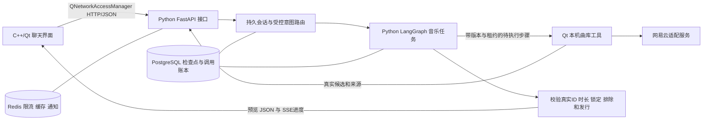

# 探歌后台迁移到 Python

日期：2026-10-21。

本文保留 Python 迁移当时使用 PostgreSQL 的流程与成绩。后续已切换 MySQL，见 [MySQL 迁移说明](MYSQL_MIGRATION.md)；旧 Node AI 后台和历史执行脚本已从当前源码树移除，见 [清理说明](LEGACY_CLEANUP.md)。当前配置与运行方式以下方“现在怎么运行”和 [Python 后台](../backend_py/README.md)为准。

## 这次做了什么

把当前账号、会话、意图路由和音乐任务后台从 JavaScript 迁成 Python，并接回已有 C++/Qt 客户端。后端现在使用 FastAPI、Uvicorn、HTTPX 和 Python LangGraph，数据库继续使用 PostgreSQL＋Redis，本机 SQLite 兼容模式保留。

这是语言和运行环境迁移，没有借此宣称新增 MCP、动态 Supervisor 或新的推荐效果。迁移时使用旧 JavaScript 源码作兼容性对照，其后已私有归档；冻结证据保留原版本范围。网易云第三方适配服务仍使用 Node.js。

## 是怎么接入的



1. Qt 继续把消息发送到原 `/v1/conversations`、`/v1/tasks` 等接口，JSON 字段、会话令牌和 SSE 格式保持兼容。
2. Python 保存消息和幂等回执；显式请求路由后，读取已保存的上下文，选择直接回复、澄清、偏好提议、任务控制或音乐任务。
3. 音乐任务由真实 Python `StateGraph` 执行理解、研究、派发、观察与编排节点；模型调用前在数据库预留额度，失败和结果不明也计数。
4. 曲库查询继续由 Qt 本机工具执行，提交真实候选。Cookie、播放地址和网易云授权留在设备；AI 后台不替用户获取播放权益。
5. 程序校验来源与硬约束，保存预览；用户采用后才更新队列。偏好也仍需用户确认后写入本机。
6. 任务进度通过 SSE 显示。PostgreSQL 的业务检查点、CAS、执行租约和账本负责恢复与防重复；Redis 通知不能决定任务成功。

接入不需要 Python 嵌入 C++。桌面与后台是两个进程，通过稳定接口通信。启动器增加 `runtimeLanguage: "python"`、`runtimeVersion: 2` 检查，避免误连旧 Node 后台。

## 保留了哪些重要行为

- 原账号、密码格式、会话令牌摘要、表名和请求摘要兼容；没有删库重建或清空额度。
- 重复消息、任务和操作按原 ID 查询／重放，冲突内容拒绝；历史恢复不会自动执行旧计划。
- 用户、设备、任务版本与租约均核验，旧 worker 的迟到结果不能覆盖新状态。
- 账号日／累计额度、全局预算、共享模型槽位和 Redis 故障时拒绝新调用的规则保留。
- 连续修改、精确保留锁定曲目、时长编排、排除、新作身份校验、撤回、暂停、继续与采用流程保留。
- 不确定的已发起调用保存为未知状态，恢复时不会自动重发计费请求。
- Python 的时长动态规划使用固定宽度数组，计算移到工作线程，避免阻塞 HTTP 与租约心跳；本次没有做语言性能排名。

## 实际测了什么

最终完整命令：

```bash
backend_py/.venv/bin/python backend_py/tests/run_storage_suite.py \
  --log /tmp/tango-python-full-release.log \
  -- tests -q --tb=short -ra --junitxml=/tmp/tango-python-full-release.xml
```

结果：**610 通过，2 跳过，0 失败，17.14 秒**。临时 PostgreSQL、Redis 均真实启动并在测试后清理，没有使用真实用户库、真实 Qwen 或真实曲库。跳过的两项都是 SQLite 不提供 PostgreSQL 分布式租约；对应 PG 项已执行。

| 验证内容 | 实际覆盖 |
| --- | --- |
| JS/Python 同题对照 | 49 份路由计划／拒绝结果，402 份任务纯函数结果逐字段一致 |
| 完整工作流对照 | 冻结旧 JS 实际 LangGraph 的需求、预览、预算、节点和模型调用序列，在 Python SQLite／PG 对比 |
| 账号与旧数据 | 两种数据库的 Node→Python→Node 密码、会话、任务 JSON 和请求账本互通；Han 用户名边界 |
| 并发与恢复 | 邀请码原子消费、额度回滚、CAS、同账号调用串行、跨 worker 槽位、租约过期和迟到结果隔离 |
| HTTP 与模型边界 | 请求大小、认证、非法 JSON、取消、超时、响应上限、重定向、候选 ID 与空工具调用字段 |
| 实际客户端 | 构建现有 Qt 客户端类，直连真实 Python HTTP 进程，完成注册、能力协商、会话恢复、路由、工具结果、预览与采用 |
| 本机启动 | 普通 16382、开发 16383 均返回 Python＋PostgreSQL＋Redis、ready=true；受保护开发入口和客户端能力协商通过 |

Qt 程序内部为 **5 项业务测试＋2 项生命周期检查**，其运行在上述 pytest 中计为 **1 项集成测试**，不能再相加。所有测试都是兼容性与工程验证，**不是 Agent 推荐准确率或用户任务总体完成率**。真实模型调用为 0，历史 499/500 的付费评测账本保持原适用范围。

首次检查发现并修复了：旧 API 租约取消信号未转发、Python 默认 JSON 解析接受 NaN/Infinity、空数组／对象真值差异、数字 ID 投影差异、旧 Han 用户名和历史来源名称兼容问题。原始失败及修复后记录保留。另有一次 Qt 测试链接依赖漏加、一次测试误把 PG 有效待工具租约期望为立即暂停，分别修复构建配置与测试断言，没有放宽业务守卫。

完整结果、源码摘要和日志见 [迁移证据](agent-upgrade/python-migration-verification.json)。

## 现在怎么运行

双击 `run-macos.command` 或 VS Code 按 F5，仍然使用原来的方法；准备脚本会用 `uv` 安装 Python 3.12 环境并启动新后台。首次需要 `brew install uv`。

单独运行后台：`bash scripts/start-app-backend.sh`。当前模型配置为 `backend_py/.env`，共享存储配置为 `.local/mysql-v1/storage.env`，只由后台进程读取；日志和离线兼容文件位于私有 `backend_py/.data/`。旧数据库已建立私密备份，没有把密钥、Cookie、用户库或备份加入 Git；本次清理不自动 commit／push。

源码入口见 [Python 后台说明](../backend_py/README.md)。维护者管理入口已迁为 `python -m tango_backend.admin`，必须显式指定数据库；生成邀请码只写新的 `0600` 私密文件。

## 面试可以怎么讲

“探歌使用 C++/Qt 客户端与 Python AI 后台，通过 HTTP/JSON 和 SSE 通信。我把原 Node 后台按接口契约迁到 FastAPI，用 Python LangGraph 执行音乐研究流程，并保留 PostgreSQL 检查点、幂等账本、CAS、租约和 Redis 限流。迁移用冻结的旧实现结果做差分对照，还验证了旧账号数据兼容和真实 Qt 客户端连接；工程回归不当作模型效果指标。”

- **为什么没有重写 C++ 界面？** 接口契约与界面技术独立，替换后台运行环境即可。
- **有 LangGraph 为什么还要数据库状态？** 图负责节点编排；账号权限、额度、幂等、业务恢复和并发版本由应用的持久状态负责。
- **迁移怎么保证没有丢功能？** 同题差分、跨语言数据互通、故障与并发回归、真实客户端连接分别验证，保留失败与适用范围。
- **换 Python 是否让推荐更准？** 语言本身没有这个结论。推荐收益仍需新的独立题、真实曲库与人工评价。

后续继续原路线第 3 步：真实 MCP 工具链。迁移没有改变该阶段尚未完成的状态；新一轮真实语义评测需重新冻结 Python 版本并获得新增模型预算。
